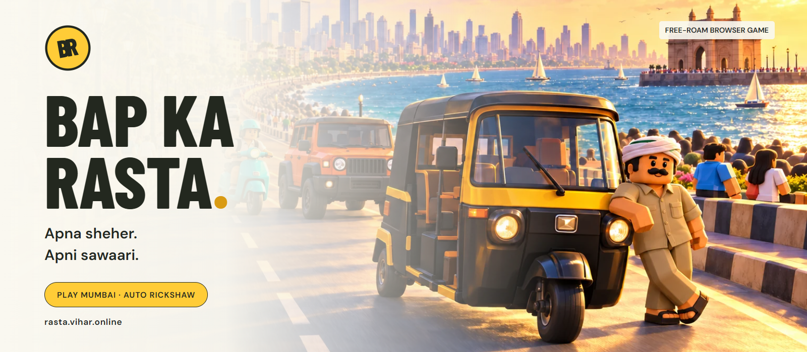
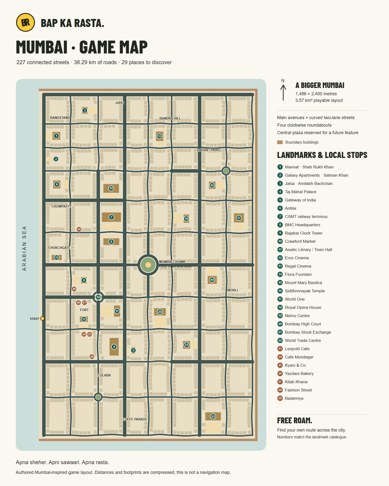

# Bap ka Rasta

[](https://github.com/tirthankardgen-cell/Bap-Ka-Rasta/actions/workflows/ci.yml)

**Apna sheher. Apni sawaari. Apna rasta.**

A single-player, browser-based 3D driving game inspired by Indian streets. Explore a Mumbai-inspired city in a black-and-yellow auto rickshaw or a turquoise scooty with Riya, a female rider, sharing the roads with traffic, pedestrians, and street vendors.

Built with React, TypeScript, Vite, and Three.js. The game runs entirely in the browser and can be deployed as a static site without accounts, a backend, API keys, or a database.

[Play the live demo](https://rasta.vihar.online) · [Browse the documentation](docs/README.md) · [Contribute](CONTRIBUTING.md) · [Get support](SUPPORT.md)



*The BR brand cover uses the original generated landing artwork. Gameplay combines an authored procedural city with Blender models for 29 Mumbai landmarks and shops, the auto and the character cast.*

[](docs/maps/mumbai-game-map.svg)

*The playable 3.57 km² environment: main avenues, curved two-lane streets, four roundabouts and 29 numbered destinations. Generated from the game's road, landmark and building data. [Landmark catalogue](docs/Mumbai-Landmarks.md) · [Blender and in-game previews](docs/mumbai-landmarks/README.md).*

[Quick start](#quick-start) · [How to play](#how-to-play) · [Development](#development) · [Project structure](#project-structure) · [Deployment](#deployment) · [Documentation](#documentation) · [Credits and licensing](#credits-and-licensing)

## Current build

The project is an early playable prototype. Mumbai, the auto rickshaw and the scooty are available; the remaining city and vehicle galleries show concept previews.

| Content | Playable now | Planned content shown in the galleries |
| --- | --- | --- |
| Cities | Mumbai | Delhi, Kolkata, Chennai, Bangalore |
| Player vehicles | Auto rickshaw, Scooty | Thar, Fortuner, KTM, Toto e-rickshaw |

The current build includes:

- **Playable scooty:** a turquoise scooter with Riya, a helmeted rider, automatic acceleration up to 60 km/h, reversed steering, gentle banking, a smaller collision footprint and third-person/rider-eye cameras. Braking moves the rider forward toward the handlebars, rises from the seat and plants both feet on the road before slowing. These comedy mechanics belong to the scooty, regardless of rider gender. It starts directly without the auto's voiced opening; backing up is limited to walking pace.
- **Connected streets:** 227 road segments, 100 signalized intersections and 38.29 km of road centreline across a 1,488 × 2,400 m city inspired by Colaba, Fort, Worli, Dadar, Bandra and Juhu.
- **Neighbourhood lanes:** 126 narrow streets with one lane each way, including 91 curved segments distributed across all four map quadrants. Four clockwise roundabouts include the large central Mumbai Chowk, Fort Circle and smaller Dadar/Cuffe Parade garden circles.
- **Recognisable destinations:** 29 [Blender landmarks, celebrity homes and shops](docs/Mumbai-Landmarks.md), including Taj, Gateway, Antilia, CSMT, Mannat, Galaxy, Jalsa, Mount Mary, Siddhivinayak, World One and World Trade Centre. Detailed façades, terraces, domes and local shop signs use original geometry and masonry textures. Open approaches keep the landmarks visible from the street.
- **Mumbai-inspired architecture:** Art Deco curved balconies, Fort-style stone arches, tiled-roof chawls, shared galleries, laundry, shopfronts and rooftop tanks. The auto has an open cabin, patterned seating, a round front lamp and coloured trim under warmer sunset lighting. These are custom interpretations of the supplied reference.
- **Street activity:** 112 moving traffic vehicles and 4,472 crowd actors, including the original 19 named locals and individually named background people, with walking, browsing, chatting, working and mid-block crossing activity. All twenty character designs use [Blender models based on the cast boards](assets/characters/mumbai/README.md), including Sachin's seated driver and first-person hands. Rendering stays local, with bounded detailed characters and shared distant models.
- **Consistent scale:** 1.56–1.81 m standing character profiles, a 0.16 m pavement, a 2.08 m auto canopy, 1.55 m cars and 3.10 m BEST midi buses. Vehicle lengths also inform collisions and traffic following.
- **Arcade driving:** acceleration, steering, braking, delayed reverse, vehicle and roadside collisions, and safe vehicle reset. The auto reaches approximately 65 km/h.
- **Voiced driver opening and street conversations:** 119 varied Hindi lines with occasional Marathi phrases, recorded using free ElevenLabs voices. Neighbours gossip independently of the auto; distance changes their volume. Sentences finish before replies, and captions appear only for speech directed at the player. The opening remains skippable and supports reduced motion.
- **Landscape mobile experience:** city selection, vehicle selection and driving automatically use a landscape canvas, even when a phone is upright. No rotate-phone prompt or orientation pause. The home page follows the phone normally.
- **Four selectable gears:** centre buttons or number-row/numpad keys 1–4 select 12, 25, 45 and 65 km/h limits, with smooth downshifts and gear-aware engine sound.
- **Desktop and touch controls:** simultaneous steering and acceleration, responsive galleries, two camera views (third person and driver eye) with drag-to-look and smooth return, and a HUD with speed, street names, and signal warnings.
- **Recorded street audio:** an engine loop, horn, traffic, and market ambience, with driving-sensitive engine sound and nearby activity mixing.
- **Session controls:** pause/resume, sound toggle, Standard/Low graphics, automatic pause on focus loss, and a retry screen for graphics context loss.

Driving is open-ended free roaming. There are no laps, objectives, minimap, results screen, or saved progress in this build. The [original game plan](docs/Bap-ka-Rasta-Game-Plan.md) describes a broader release scope; the [playable guide](docs/Mumbai-Playable.md) describes the implementation.

## Quick start

### Requirements

- **Node.js 24** (recommended), or **Node.js 22.18+** on the 22.x release line, with npm. The simulation tests use Node's native TypeScript support.
- **Git** to clone the repository.
- A modern browser with **WebGL 2** and hardware acceleration enabled.

```sh
git clone https://github.com/tirthankardgen-cell/Bap-Ka-Rasta.git
cd Bap-Ka-Rasta
npm ci
npm run dev
```

Open [http://localhost:5173](http://localhost:5173), or the URL printed by Vite if that port is occupied. No `.env` file is required.

The development server binds to `0.0.0.0`. To try touch controls on a phone connected to the same network, use the Network URL printed by Vite and allow the development server through your local firewall if needed.

## How to play

1. Select **Mera Bap Ka Rasta** on the landing page.
2. Choose **Mumbai**, then select **Yahin Chalao**.
3. Choose **Auto rickshaw** or **Scooty**, then select **Drive Mumbai**.
4. Select **Chal Chala** to start driving and unlock browser audio.

The city and vehicle galleries support arrow buttons, Left/Right arrow keys, swipe gestures, and selection dots. **Escape** returns to the previous screen. Entries marked **Coming soon** cannot start a drive.

### Driving controls

| Action | Keyboard | On-screen control |
| --- | --- | --- |
| Accelerate | `W` / `ArrowUp` | Hold **Chalao** (up arrow) |
| Brake, then reverse | `S` / `ArrowDown` | Hold **Ruko / reverse** (down arrow) |
| Steer left / right | `A` / `D` or `ArrowLeft` / `ArrowRight` | Hold the steering arrows |
| Handbrake | `Space` | Use the brake/reverse pedal for touch braking |
| Horn | `H` | Horn button |
| Cycle camera | `C` | Camera button: **3P / 1P** |
| Reset to a safe road position | `R` | Reset button |
| Pause | `Escape` / `P` | Pause button |
| Resume | Select the resume button | **Chal, phir niklein** in the pause panel |
| Sound on / off | Select the sound button | Speaker button or pause-panel sound toggle |

Keep holding brake after stopping to reverse; reverse engages after a short delay. Steering and acceleration can be held together. Switching tabs or losing focus pauses the game and clears held inputs; resume explicitly when returning.

**Scooty controls:** left input turns right and right input turns left, on keyboard and touch. `S` / `ArrowDown` or the **Pair brake** pedal moves the rider forward, rises from the seat and lowers both feet to the road. Foot braking begins once the soles touch down, after a 0.24-second transition; release to sit back and lift the feet. `Space` uses the same foot brake without reversing. Reduced motion shows the planted pose immediately. The auto keeps its normal steering and brakes.

The pause panel also lets you change graphics quality and end the drive. **Aaj ka ho gaya** and **Ghar chalo** return to the landing page.

## Development

### Technology

| Area | Implementation |
| --- | --- |
| Interface | React 19, TypeScript, CSS, and Lucide icons |
| Rendering | Three.js with an imperative renderer and procedural geometry |
| Driving and traffic | Custom TypeScript simulation with a 60 Hz fixed step |
| Audio | Web Audio API with locally served MP3 excerpts |
| Build tooling | Vite 6 and TypeScript 5.9 |
| Tests | Node.js built-in test runner and Playwright |
| Fonts | Barlow Condensed and DM Sans, served locally through Fontsource |

Dependency versions are recorded in [package.json](package.json) and [package-lock.json](package-lock.json). Use `npm ci` for a reproducible installation.

### Commands

Run these commands from the repository root:

| Command | Purpose |
| --- | --- |
| `npm run dev` | Start the Vite development server, normally on port 5173 |
| `npm run build` | Run TypeScript checks, build to `dist/`, and prerender the landing screen for crawlers and initial display |
| `npm run preview` | Serve the existing production build locally, normally on port 4173 |
| `npm run verify:search` | Check the built public pages, game guide, metadata, sitemap, favicons and linked assets; `VERIFY_SITE_URL` selects a live site |
| `npm test` | Run simulation and pavement-layout tests |
| `npm run test:e2e` | Run Playwright browser tests against a production build |
| `npm run voices:generate` | Regenerate missing/changed voice files using the private ElevenLabs key and included voices |
| `npm run voices:catalogue` | Rebuild runtime voice metadata, the line list and every person's voice assignment |
| `npm run voices:verify` | Check all voice assets, gender assignments, short durations, hashes and attribution |
| `node scripts/landmarks/build_catalogue.mts` | Rebuild the landmark, shop, road and physical-scale catalogue |
| `node scripts/build-game-map.mts` | Regenerate the numbered playable map from the actual layout |

### Verification

```sh
npm test
npm run build
npx playwright install chromium
npm run test:e2e
```

The browser installation is needed on first setup and may be needed after a Playwright upgrade. Build before running browser tests: Playwright starts `npm run preview -- --port 4175` and uses the existing `dist/` directory; it does not build the app itself.

- **Simulation and layout tests** cover road connectivity, pavements, speed limits, braking/reverse, steering, collisions, safe resets, signal phases, pedestrian yielding, and extended simulated traffic and driving.
- **Browser tests** cover city/vehicle selection, responsive galleries, driving controls, touch input, the opening/skip/reduced-motion flow, two camera modes, pause/reset/exit, audio loading and lifecycle, and graphics context-loss recovery.

The browser configuration uses Chromium with software WebGL. `PLAYWRIGHT_CHROMIUM_EXECUTABLE_PATH` can point to an installed Chromium-compatible browser. See [playwright.config.ts](playwright.config.ts) for the server, timeout, and browser settings. Screenshots and test output are written to `test-results/`.

Before submitting a change, run the checks relevant to it and update documentation when controls, availability, or setup steps change. Keep audio attribution alongside any added or edited recordings.

The [CI workflow](.github/workflows/ci.yml) checks the production build, simulation/layout tests, and research-audio manifest on pull requests and pushes to `main`. Browser tests remain a separate local check. The Blender-character integration passed all 24 browser tests in Chrome, including loading retry and graphics-context recovery; this does not measure performance on a physical phone. [Dependabot](.github/dependabot.yml) is configured for weekly dependency and workflow-action updates.

## Project structure

```text
src/
  main.tsx                Landing page, screen navigation, and lazy game loading
  style.css               Landing-page and shared styles
  selection/              City and vehicle galleries
  game/
    Game.tsx              HUD, start/pause/error panels, and touch controls
    engine.ts             Renderer, game loop, input, camera, and cleanup
    simulation.ts         Vehicle movement, traffic, collisions, and resets
    network.ts            Road graph, lanes, signals, crossings, and obstacles
    pavements.ts          Raised-pavement layout and road clearance
    world.ts              City geometry, landmarks, pedestrians, and traffic rendering
    vehicles.ts           Player and traffic vehicle geometry
    atmosphere.ts         Sky, lighting, reflections, fog, and shadows
    audio.ts              Recorded audio loading, playback, mixing, and cleanup
    game.css              Driving interface styles
public/
  images/                 WebP landing and gallery artwork
  audio/                  Four street stems, 119 character clips, credits and licenses
assets/audio/mumbai/      Research recordings, listening catalogue, and manifest
tests/                   Simulation/layout tests and browser flows
docs/                    Playable guide, game plan, storyboards, and research
scripts/                 Documentation generation and research/audio verification
output/                  Generated HTML and PDF editions of the game plan
```

React owns the screens and HUD; the game engine owns rendering and simulation. The game module loads after vehicle selection. Simulation runs at a fixed step with bounded catch-up, while HUD updates are throttled to approximately 10 Hz. Repeated scenery and traffic use shared or instanced geometry. Ending a drive disposes renderer resources, input listeners, and audio.

Vite copies `public/` into the build. The research recordings, original voice exports in `assets/`, and design documents stay outside the game bundle. The four street stems load after the sound gesture; character speech loads only for the current line and its related reply. No ElevenLabs key or runtime API call is needed to play.

## Deployment

### Vercel

1. Import [tirthankardgen-cell/Bap-Ka-Rasta](https://github.com/tirthankardgen-cell/Bap-Ka-Rasta) into Vercel.
2. Use the repository root as the **Root Directory**.
3. Select the **Vite** framework preset and a supported Node.js version from the requirements above.
4. Use **`npm run build`** as the build command and **`dist`** as the output directory.
5. Deploy. No environment variables are required.

The framework, build command, and output directory are already declared in [vercel.json](vercel.json).

### Other static hosts

Run `npm run build` and publish the contents of `dist/` at the site's root. Asset URLs use absolute paths such as `/images/` and `/audio/`; hosting beneath a subdirectory requires corresponding code and build-path changes. `npm run preview` is for local verification, not a production hosting service.

## Documentation

| Resource | What it covers |
| --- | --- |
| [Mumbai playable guide](docs/Mumbai-Playable.md) | Current gameplay, controls, runtime modules, and validation limits |
| [Game design and architecture](docs/Bap-ka-Rasta-Game-Plan.md) | Original product scope, proposed architecture, and development milestones |
| [Game plan PDF](output/pdf/Bap-ka-Rasta-Game-Plan.pdf) / [HTML edition](output/Bap-ka-Rasta-Game-Plan.html) | Generated, readable editions of the design document |
| [Visual storyboards](docs/storyboard/README.md) | City, vehicle, character, and player-journey concept references |
| [Mumbai map research](docs/research/mumbai/README.md) | Geographic references, authored-map boundaries, and attribution |
| [Street audio research](docs/research/mumbai/audio/README.md) | Recording sources, locations, licenses, and coverage |
| [Audio library](assets/audio/mumbai/README.md) / [listening catalogue](assets/audio/mumbai/listen.html) | Local source recordings and playback |
| [Primary source verification](docs/research/source-checks.json) | Recorded research evidence for the design document |
| [Roadmap](docs/ROADMAP.md) | Reliability priorities and planned content expansion |
| [Changelog](CHANGELOG.md) | Notable development changes |
| [Maintainer guide](docs/MAINTAINERS.md) | Repository profile, CI, and publication workflow |

The game plan and storyboards describe intended features and technology choices. For example, the plan proposes React Three Fiber and Vitest; the current code uses direct Three.js and Node's test runner. Use this README and the playable guide for current setup and behavior.

### Optional documentation and research tools

Python is needed only for these utilities. The game itself uses the npm workflow above.

| Command | Requirements and output |
| --- | --- |
| `python scripts/verify_audio_assets.py` | Python 3.9+; checks the research audio manifest, file sizes, SHA-256 hashes, credits, and license files using the standard library |
| `python scripts/research_sources.py` | Python and `requests`; fetches primary references and rewrites `docs/research/source-checks.json` |
| `python scripts/build_game_plan.py` | Python, `reportlab`, and `pypdf`; generates the game plan PDF/HTML and document checks |

Optional audio inspection:

```sh
python scripts/verify_audio_assets.py --ffprobe ffprobe --ffmpeg ffmpeg
```

This requires FFmpeg and ffprobe on `PATH`; each flag also accepts an executable path. `--ffprobe` validates stream metadata and `--ffmpeg` fully decodes each recording. Both checks are optional.

For the research and document-generation tools, install the relevant Python packages in your preferred virtual environment:

```sh
python -m pip install requests reportlab pypdf
```

The PDF builder currently uses Segoe UI and Consolas from `C:/Windows/Fonts`. On another operating system, update `register_fonts()` in `scripts/build_game_plan.py` to use available fonts. The source-research script records a fixed `CHECKED` date of `2026-10-24`; update it when refreshing the research. The PDF builder also checks the saved source-verification record.

## Known limitations and troubleshooting

- **Prototype scope:** Mumbai is playable with the auto rickshaw or scooty. The other galleries and design documents contain future content.
- **Map fidelity:** the streets and landmark positions form an independently authored, compressed Mumbai-inspired game layout. Published building heights are identified separately from visual estimates in the catalogue; footprints and routes are not survey data. There is no live map integration.
- **Device coverage:** automated browser checks use Chromium and simulated touch. Real Android/iOS performance, Safari compatibility, and extended manual playtesting still need validation.
- **Low frame rate:** enable browser hardware acceleration and switch to **Low graphics** in the pause panel. This reduces rendering resolution and fog distance and disables shadows.
- **Graphics unavailable:** use a WebGL 2-capable browser. If the graphics context is lost during a drive, use the retry action shown on screen.
- **No sound:** select **Chal Chala** first, check the speaker toggle, and toggle sound off/on to retry a failed audio download.
- **Test runner rejects `--experimental-strip-types`:** check `node --version` and switch to the Node.js version listed under requirements.
- **Browser tests cannot start:** build the app, install Chromium, and ensure port `4175` is available or already serving this project's current production build.

## Contributing and community

Read [CONTRIBUTING.md](CONTRIBUTING.md) for setup, code conventions, validation, assets, and pull requests. Use the [issue forms](https://github.com/tirthankardgen-cell/Bap-Ka-Rasta/issues/new/choose) for bugs, feature proposals, or support questions, and follow the [Code of Conduct](CODE_OF_CONDUCT.md) when participating.

Report vulnerabilities privately using [SECURITY.md](SECURITY.md). The [support guide](SUPPORT.md) covers troubleshooting and general questions. This is a development prototype; the [roadmap](docs/ROADMAP.md) describes priorities without promising release dates.

## Credits and licensing

Audio is drawn from credited Freesound recordings. The [research library attribution](assets/audio/mumbai/ATTRIBUTION.md), [manifest](assets/audio/mumbai/manifest.json), and [license texts](assets/audio/mumbai/licenses/) record each source and its terms. The collection uses CC0 1.0, CC BY 4.0, and CC BY 3.0 licenses.

The four gameplay excerpts have their own [deployed credits](public/audio/credits.html), available at `/audio/credits.html` and through the pause panel. The horn excerpt comes from a Jaipur electric-rickshaw recording; its provenance is documented with the other clips. Preserve the credits and modification notes when reusing audio.

The [119 character recordings](docs/mumbai-characters/VOICE-LINES.md) use free-account ElevenLabs voices and require attribution and non-commercial use. They do not inherit the field recordings' Creative Commons licenses. See the [voice production guide](assets/audio/mumbai/voices/README.md) for casting, every person's assignment, generation commands, and verification. [Listen to the voice pack](public/audio/mumbai/voices/index.html).

The municipal reference illustration uses DataMeet data under **CC BY-SA 2.5 India**; see the [map attribution](docs/research/mumbai/README.md). Landing/gallery images and storyboards are original generated concept artwork. Font licenses are included with their upstream Fontsource packages.

The original game code remains **unlicensed**, recorded as `UNLICENSED` in the package metadata. [NOTICE.md](NOTICE.md) summarizes the applicable attribution and licensing boundaries. Individual asset and dependency licenses apply to their respective materials and do not establish a license for the game code.
