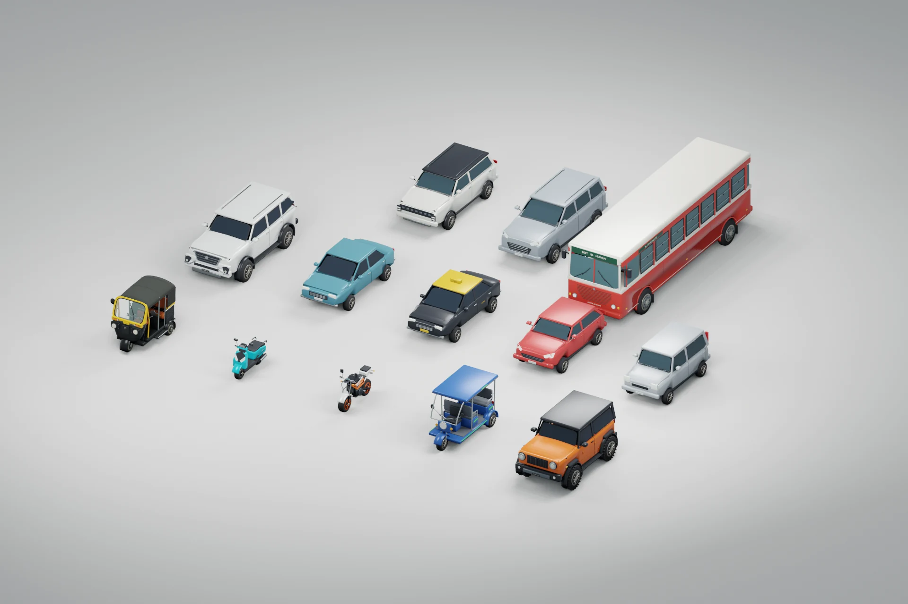

# Mumbai vehicle library

`gallery-traffic.blend` contains all **13 editable vehicles** in one scene, with a
studio camera and packed photo reference boards. The auto also retains its own
source file in `../mumbai-auto/`. Geometry, material regions, cabin controls and
axle-centred wheel pivots remain editable.



The real photographs supplied in `ref vech/` guide silhouettes, construction and
details; the gallery artwork guides the orange/white/turquoise/blue street palette.
These are original, stylised game meshes, with simplified cabins and dark glazing.
The references are modelling guides, not image planes or textures on the vehicles.

| Vehicle | Reference | Modelled features |
| --- | --- | --- |
| Mumbai auto | Auto front, side, dashboard and three-quarter photos | Open-backed pressed cowl, twin round lamps, yellow indicator band and screen returns, black mudguard, suspension, seat-back partition, rear passenger-facing meter, handlebar controls and working speedometer |
| Thar | `thar actual.png` | Short three-door body, black hardtop, round lamps, slotted grille, flared arches, off-road tyres, spare wheel, bonnet latches, hinges, running boards and rear glazing |
| Fortuner | `fortuner actual.png` | Sloping bonnet and windshield, swept lights, trapezoidal chrome grille, integrated bumper, quarter glass, roof rails, running boards and third-row cabin |
| Electric rickshaw | `e riksha actual .png` | Thin canopy, bowed open front hoop, separate driver saddle, two facing two-person benches, open passenger entry, battery boxes, grab handles and electric axle |
| Dio-style scooter | `scooty actual .png` | Step-through floor, sculpted apron, low swept lamps, connected steering neck, instrument cover, stepped saddle, CVT case, exhaust shield and suspension |
| Duke-style KTM | `Ktm actual.png` | Exposed orange trellis, white tank shrouds, compact naked-bike headlamp, engine and radiator, swingarm, chain, brake discs, controls, indicators and rear spring |
| BEST bus | `mumbai red bus.jfif` | Rounded white roof, green route board, split front glazing, broad louvred red nose, low round lamps, red bumper, steel wheels, folding entry doors, seats and handrails |
| Sedan and kaali-peeli taxi | Extra-car reference sheet; local taxi palette | Separate bonnet/boot, hollow cabin, seats and right-hand-drive controls, lights, door seams, plates and taxi roof sign |
| Swift-style hatchback | Extra-car reference sheet | Short body and bonnet, swept lamps, hatch glazing and six-spoke wheels |
| Wagon R-style tall hatch | Extra-car reference sheet | Tall glasshouse, upright rear, high bonnet and vertical tail lamps |
| Creta-style compact SUV | Extra-car reference sheet | Two-tone roof, split lamps, full-width light strips, grille blocks and black arch trim |
| Innova-style MPV | Extra-car reference sheet | Longer three-row cabin, quarter windows, chrome grille, swept lamps and roof rails |

## Runtime contract

- `public/models/gallery-traffic.glb` contains the twelve traffic templates; the
  player/traffic auto comes from `public/models/mumbai-auto.glb`.
- Metres, Y up, +Z forward, ground origin. Runtime roots have zero studio placement.
- Root extras include `traffic_kind` and reference paths. Wheels have stable names
  and `wheelRadius` extras; they rotate about local X. Glass, interiors and controls
  have separate semantic parts. Traffic riders are included in the export and
  hidden only for unobstructed studio reviews.
- `manifest.json` records every model, dimensions, wheel centres, triangle counts,
  compression and the SHA-256 of the actual GLB. Meshopt compression is decoded by
  the same bundled decoder already used elsewhere in the game.
- There is exactly one scene in each GLB. Studio cameras, lighting and reference
  photographs are excluded. Downloads, cancellation and cleanup are session owned.
- All thirteen kinds appear in city traffic. Parked taxis use the same Blender
  library. The auto and scooty are player-selectable; the other rides remain previews.
- The playable scooty clones this library's scooter and seated body. Riya, its
  female rider, uses a fitted head and ponytail from the existing Pooja cast mesh
  with an original open-face helmet. `src/game/scooty-model.ts` assembles these
  session-owned parts, head-free first-person body, wheel steering and banking
  without modifying the Blender source or other traffic riders. Its automatic
  controller reaches 60 km/h and uses the scooter's physical dimensions.

## Save edits from the open Blender session

With both vehicle scenes open and Blender in Object Mode, save the current models
and update the game's exports without regenerating geometry:

```powershell
python scripts/landmarks/blender_bridge.py scripts/vehicles/export_open_vehicles.py
node scripts/vehicles/pack_gallery_traffic.mjs
blender --background --factory-startup --python-exit-code 1 --python scripts/vehicles/verify_vehicle_library.py
npm test
npm run build
```

The saver first backs up the entire open session and the previous vehicle files
under ignored `output/playwright/saved-models-*/`. It writes isolated `.blend`
sources and grounded GLB templates, restores studio placement and rider visibility,
and refreshes dimensions, wheel centres and geometry counts in the manifests.
The source check also verifies that the lineup auto matches its dedicated source.

## Rebuild

Start the Blender bridge on `127.0.0.1:9876`, then run from the repository root
with Python 3.11+ and Node 24 (or Node 22.18+):

```powershell
python scripts/landmarks/blender_bridge.py scripts/vehicles/build_mumbai_auto.py
python scripts/landmarks/blender_bridge.py scripts/vehicles/build_gallery_traffic.py
node scripts/vehicles/pack_gallery_traffic.mjs
python scripts/landmarks/blender_bridge.py scripts/vehicles/stage_gallery_traffic.py
python scripts/landmarks/blender_bridge.py scripts/vehicles/render_vehicle_reviews.py
python scripts/landmarks/blender_bridge.py scripts/vehicles/render_auto_cabin.py
blender --background --factory-startup --python-exit-code 1 --python scripts/vehicles/verify_vehicle_library.py
npm test
npm run build
npm run test:e2e
```

Builders replace only their generated scenes. Export uses both `use_selection`
and `use_active_scene`; omitting the latter allows selected objects in another
open scene to leak into a Blender 3.5 GLB. Source files are written with
`bpy.data.libraries.write`, excluding unrelated scenes instead of saving the
entire open Blender session.

The lineup and per-vehicle front/side/rear reviews are saved under
`output/playwright/vehicles/`. `VEHICLE_REVIEW_NAMES` and `VEHICLE_REVIEW_VIEWS`
can filter renders. The review script restores placement, visibility and camera
settings after rendering. Blender 3.5.1 was used for the delivered files.

The supplied photos retain their original rights; the project does not grant a
new licence to them. Repository licensing continues to apply to authored assets.
