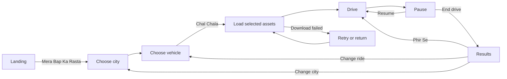
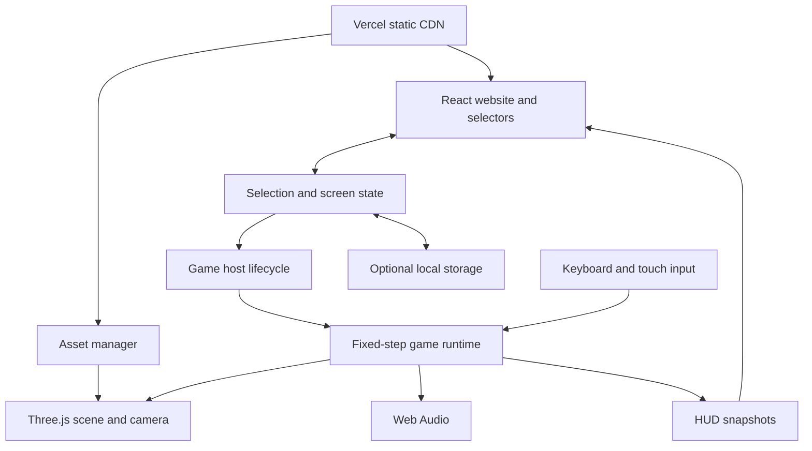

# Bap ka Rasta Game Design and Architecture

Product specification and implementation plan  
Version 1 revision 1 | 24 October 2026

## 1 Project decision

Bap ka Rasta will be a lightweight, single-player, 3D arcade driving website with an Indian street setting. A visitor opens the website, presses **Mera Bap Ka Rasta**, chooses a city, chooses a vehicle, and starts driving. Every launch city and vehicle is available immediately. The game runs in the browser and requires no account, download, payment, or installation.

The recommended implementation is **React, TypeScript, Vite, and Three.js through React Three Fiber**, hosted as a static application on **Vercel**. Driving uses a small arcade simulation rather than a full vehicle physics engine. Reusable road pieces and scenery create five recognisable city circuits while keeping the active download and rendering workload small.

This document defines the product, player experience, city and vehicle content, software architecture, asset pipeline, performance budgets, deployment approach, and implementation milestones. It is the specification for building the game from an empty project. Performance numbers and development effort are proposed targets; they become verified results when a playable build is measured.

| Item | Version 1 decision |
| --- | --- |
| Working game name | Bap ka Rasta |
| Main landing button | Mera Bap Ka Rasta |
| Launch cities | Mumbai, Delhi, Kolkata, Chennai, Bangalore |
| Launch vehicles | Auto rickshaw, Thar, Fortuner, scooty, KTM |
| Main mode | Relaxed free driving around a city circuit |
| Platforms | Desktop and mobile browsers with WebGL 2 |
| Hosting | Vercel static deployment |
| Accounts and backend | No login, database, or game server in Version 1 |
| Art direction | Original, stylised, low-poly Indian streets |

Build a Mumbai and auto rickshaw prototype first to establish the controls, road system, and mobile performance. Then extend the same engine to all five vehicles and cities before the public Version 1 launch. The prototype is a development milestone, not a reduction of the requested launch roster.

## 2 Research and technology choice

### What the primary sources establish

Vite produces a static build, normally in `dist`, and Vercel supports Vite projects directly. This fits a browser game whose simulation runs on the player's device. Vercel serves the website and asset files; it does not need to run a continuous driving simulation. `vite preview` is for local build inspection rather than the production server. [S01, S02]

The current Three.js WebGL renderer requires WebGL 2; WebGL 1 support ended in r163. The game therefore needs a capability check and a useful unsupported-device screen. WebGPU can be evaluated later, but it is not required for this launch. [S03]

React Three Fiber's guidance recommends mutating objects inside `useFrame` for fast updates and avoiding React state updates in frame loops. Its performance guidance and Three.js `InstancedMesh` documentation support sharing geometry and materials and instancing repeated objects. These are directly relevant to road markings, trees, lamps, shops, and traffic. [S04, S05, S06]

`GLTFLoader` supports compressed geometry and texture extensions, including Meshopt and KTX2 when the matching decoder or loader is configured. glTF Transform provides an asset optimization pipeline. These capabilities help keep 3D downloads manageable, but actual savings must be measured on the models produced for this game. [S07, S22]

Browser input, audio, and lifecycle constraints matter as much as graphics. Pointer Events support touch and mouse input, audio should be unlocked by a user gesture, and background pages may suspend animation callbacks. Local storage can be blocked or unavailable, so saving settings must be optional. [S09, S10, S11, S12]

### Engine options

| Option | Fit for this project | Main tradeoff | Decision |
| --- | --- | --- | --- |
| React with Three.js and React Three Fiber | Good separation between website screens and a custom 3D game loop | Requires explicit ownership of physics, traffic, and assets | Recommended |
| Direct Three.js with a small UI layer | Strong control over a compact rendering runtime | More manual coordination of menus, settings, and loading | Good alternative |
| Babylon.js | Complete browser 3D engine with many built-in capabilities | Broader engine surface than this first game needs | Keep as an alternative |
| Godot web export | Useful editor and established game workflow | WebAssembly export and browser constraints add deployment considerations | Use if an editor-led workflow becomes more important |

Babylon.js is a capable WebGL and WebGPU engine. Godot supports web export and offers single-threaded export; its threaded web path has additional cross-origin isolation requirements. Neither alternative is being rejected on a fabricated download-size or frame-rate benchmark. The recommendation follows the requested website flow, small custom driving model, and straightforward static hosting. [S15, S16]

### Proposed development stack

| Layer | Tool | Purpose |
| --- | --- | --- |
| Website UI | React and TypeScript | Landing, selectors, settings, loading, pause, and results |
| Build system | Vite | Development server and static production build |
| 3D rendering | Three.js with React Three Fiber | Scene, camera, models, lighting, and frame callback |
| Selected 3D helpers | Drei | Use only helpers that justify their cost |
| UI state | Zustand | Selection and low-frequency game screen state |
| Driving and traffic | Custom TypeScript modules | Fixed-step arcade movement and simple collisions |
| Sound | Web Audio API | Engine loops, horn, tyre sounds, and ambient layers |
| Asset preparation | Blender and glTF Transform | Original models, GLB export, optimization, and validation |
| Validation | Vitest and Playwright | Simulation tests and browser flow checks |
| Hosting | Vercel | HTTPS delivery and preview deployments |

Pin compatible versions and commit the lockfile when the application is scaffolded. React and React Three Fiber major versions must be paired according to their package requirements. This document does not install packages or claim that a compatibility build has already passed.

## 3 Launch scope

Version 1 includes all five cities, all five vehicles, a chase camera, keyboard and touch controls, light NPC traffic, simple vehicle and roadside collisions, a horn, a reset action, sound settings, quality settings, local best distance, and a results screen. It also includes loading progress, asset retry, pause on loss of focus, and an unsupported-graphics screen.

The main experience is free driving. The player can cruise, weave through light traffic, complete laps, and end a session whenever they want. Collisions slow the vehicle and reset handling without ending the game. There is no required mission before driving becomes available.

Version 1 uses a compact, continuous circuit for each city. The routes are fictional arrangements inspired by recognisable places. The project does not need a street-map provider, live traffic API, real city reconstruction, or streaming satellite imagery.

The following features belong after the first release: a timed challenge, online leaderboards, multiplayer, police chases, passenger jobs, vehicle upgrades, full interiors, realistic suspension, dynamic weather, and day-night cycling. They would change the download, testing, or server requirements substantially. Basic daylight, one camera, and simple handling should establish a stable baseline first.

## 4 Player journey and screen behavior



### Landing

Show the game name, a small original street illustration, one clear primary button, and a brief explanation: **Apna sheher. Apni sawaari. Bas chalao.** Include a compact sound toggle and a How to Play link. The first screen uses HTML, CSS, and a static illustration; it should not download or continuously render all five 3D worlds.

The primary action is **Mera Bap Ka Rasta**. It opens the location screen immediately. A non-blocking WebGL 2 check can run after that gesture. If graphics are unavailable, retain the normal page and show a browser-support message with a retry action.

### Choose city

Present five cards: Mumbai, Delhi, Kolkata, Chennai, and Bangalore. Each shows an original illustration, a short mood description, and the route name. Bangalore can carry the secondary label Bengaluru. Mumbai is preselected for convenience, but the player must be able to choose any city in one tap.

Selecting a city highlights the card. **Yahin Chalao** proceeds to vehicle selection. Back returns to the landing page without discarding settings. No city is locked behind play time or sign-up.

### Choose vehicle

Present auto rickshaw, Thar, Fortuner, scooty, and KTM cards. Each has a lightweight vehicle image, a friendly description, and simple speed and handling indicators. Start with the auto rickshaw selected. Avoid a WebGL preview for every card; a static image is enough for the first release.

The final selection summary shows the city and vehicle together. **Chal Chala** begins the game loading stage. The sound preference remains visible. If the player enables sound, resume the audio context from this button gesture before waiting for network downloads.

### Loading and driving

Load shared game code, shared scenery, the selected city pack, and the selected player vehicle. Other city packs and detailed player models stay unloaded. Show real staged progress such as **Road taiyaar ho raha hai**, **Sawaari aa rahi hai**, and **Bas nikal rahe hain**. When a loader cannot provide a byte total, show a stage label rather than a fake percentage.

After the scene, colliders, and spawn point are ready, show the controls once and begin driving. The HUD displays speed, distance, lap count, pause, horn, and reset. Keep it small enough that the road remains visible.

### Pause and results

Pause offers Resume, Reset Vehicle, Sound, Graphics, End Drive, Change Vehicle, and Change City. Changing a selection ends the current run and returns to the appropriate selector. A confirmation is unnecessary for an unranked free-drive session with no unlocks to lose.

Results show distance, completed laps, top speed, and the local best distance for that city and vehicle. **Phir Se** starts a fresh run using the loaded assets. **Sawaari Badlo** returns to vehicle selection. **Sheher Badlo** returns to city selection. A Share action can share the selection URL or copy it if native sharing is unavailable. [S26]

## 5 Name and visual identity

Use **Bap ka Rasta** as the working display name and keep its spelling consistent across the header, browser title, social preview, and results screen. The CTA can use **Mera Bap Ka Rasta** as requested. These are branding choices; domain availability and trademark clearance have not been established by this technical research.

The personality should come from familiar street details and original Hinglish writing: an auto's rear message, chai stalls, petrol pumps, painted shop signs, speed breakers, bus stops, and a slightly dramatic horn. The graphics should look like a designed arcade world rather than a collection of borrowed film clips or meme images.

| Element | Direction |
| --- | --- |
| Main background | Warm cream `#FFF4DF` |
| Primary action | Orange `#F86A2A` with readable dark or white text |
| Road and primary text | Charcoal `#20262D` |
| Secondary accent | Teal `#167D8D` |
| Accent for signs | Yellow `#F7C948` |
| UI typography | A readable, self-hosted sans-serif with a system fallback |
| 3D materials | Flat colours, a small texture atlas, and simple rough surfaces |

Check actual colour combinations for contrast before release. Orange is a brand colour, not an excuse for unreadable white text. Local script can appear on original city signage if the chosen font supports it; the core controls remain understandable in Roman Hinglish and English.

Suggested original interface copy includes **Sawaari Chun**, **Sheher Chun**, **Arre bhai, road idhar hai**, **Phir Se**, and **Horn se horsepower nahi badhta**. Horn use does not earn points. Optional jokes should not obscure important controls or repeat so often that they distract from driving.

### Street humour and pop culture

Use the attitude of Indian road banter through original writing and props. An auto can carry **Meter down, tension down**; a garage can read **Papa Ki Workshop**; a tea stall can promise **Ek chai, phir drive**. A short reset message such as **Scene ho gaya. Phir se chalao** suits a minor collision. These are proposed game copy, not attributed film dialogue or a claim that a phrase is unused elsewhere.

City flavour comes from locally recognisable food stalls, scripts, vehicles, and architecture. Keep jokes occasional and use several variants so repeated laps stay pleasant. Film scenes, celebrity faces, recognisable song samples, and copied meme audio are unnecessary for the concept; any later inclusion needs its own asset permission review. The first release can express the requested pop culture tone with entirely original art and sound.

## 6 Driving rules and replay value

### Main movement model

Use an arcade controller with forward speed, braking, steering, drag, and a simple road contact model. The camera stays behind the selected vehicle. The vehicle accelerates smoothly, turns predictably, and slows on shoulders. Scooty and KTM remain upright automatically; their bodies lean visually into turns.

The physics world uses metres, seconds, and radians. The HUD converts metres per second to km/h. The proposed vehicle speeds are arcade tuning values, not manufacturer specifications. The vehicle should still feel controllable on a phone, with speed-sensitive steering and a gentle camera.

Holding brake first decelerates. Reverse begins only after the vehicle is almost stopped and brake remains held for a short intentional delay, such as 0.4 seconds. Limit reverse to about 12 km/h. A brake press at full speed must never instantly switch the vehicle into reverse.

### Road and collision behavior

The roads use left-hand traffic. NPC vehicles follow fixed lane paths and maintain a simple gap from the vehicle ahead. They do not need to obey a complete real-world traffic system. Version 1 keeps the playable road topology simple enough to avoid complex uncontrolled intersections.

Roadside collision shapes use simple boxes or capsules. A broadphase grid finds nearby candidates, and a narrow collision check resolves only those candidates. The player slows, is pushed out of overlap, and receives a short contact cooldown so one impact does not produce repeated sounds every frame.

Use swept movement checks or conservative movement substeps at higher speeds to prevent crossing a barrier between simulation ticks. Visual details such as awnings, decorative crowds, and skyline geometry do not all need collision shapes. Moving pedestrians and pedestrian-impact gameplay are outside the initial content requirement.

### Reset and recovery

**R** or the on-screen reset button restores the player to the last valid road checkpoint. Update that checkpoint only when the player is on a safe part of the route, moving normally, and clear of traffic. Check the target against nearby NPCs before respawning, with the starting bay as a fallback.

Reset clears speed and collision impulses, resets camera smoothing, and does not add distance or lap progress. It preserves the current run statistics. A full retry starts a new run with counters at zero.

### What makes a run worth repeating

Version 1 tracks actual distance travelled, completed laps, and top speed. Local best distance is stored separately for each city and vehicle. There is no global ranking that invites score tampering or requires an account.

A later 90-second challenge can add clean-driving points, time bonuses, and near-miss events. Keeping that mode separate allows the free-drive experience to remain relaxed and easy to learn. Original route landmarks, different handling, and city-specific scenery already provide reasons to replay the first release.

## 7 City circuits and Indian street references

The city references below come from official tourism pages. They guide visual identity; the proposed road layouts, route names, traffic profiles, and distances are design decisions. The in-game circuits are compressed, fictional spaces rather than navigation tools. [S17, S18, S19, S20, S21]

| City | Proposed route | Target circuit length | Recognisable visual cues |
| --- | --- | --- | --- |
| Mumbai | Samundar Loop | 2.2 km | Marine Drive-inspired sea wall, curved seafront, dense skyline |
| Delhi | Dilli Boulevard | 2.4 km | India Gate-inspired distant arch, broad avenue, landscaped roundabout |
| Kolkata | Hooghly Hop | 1.9 km | Howrah-inspired steel bridge, riverside edge, yellow taxi scenery |
| Chennai | Marina Cruise | 2.1 km | Marina Beach-inspired coast, palms, broad beachfront road |
| Bangalore | Garden City Run | 2.0 km | Tree canopy, Cubbon Park-inspired greenery, civic building silhouette |

### Mumbai

The official Marine Drive reference describes a curved boulevard along the Arabian Sea. Build a broad seafront curve, low promenade wall, buildings set back from the carriageway, and a skyline landmark that the player sees more than once per lap. [S17]

The playable circuit alternates a coastal stretch with a compact shop street and a wider return section. Add original vada pav and chai stall signs, black-and-yellow taxi props, and a bus stop. The sea uses a flat shaded plane with a small surface animation; it does not need expensive real-time reflections.

### Delhi

Use an India Gate-inspired arch as an exterior skyline landmark, with lawns and broad approaches informed by the official reference. The circuit stays on a fictional road outside the monument area. [S18]

Wider roads make this the easiest SUV route. Add a landscaped traffic island, sandstone-coloured background buildings, an overhead metro silhouette, and original tea stall signs. The metro is background scenery in Version 1 rather than a moving rail simulation.

### Kolkata

The official Howrah Bridge reference places the bridge across the Hooghly and describes its cantilever form. Use a simplified steel silhouette with a flat playable bridge deck and a river plane below it. [S19]

The circuit moves from a riverside stretch to a narrower street with shutters, older facades, and yellow taxi traffic. Heritage tram wires or a stationary tram can be decorative references; the game need not claim that a particular tram service operates today. Keep bridge steel decorative and use a small number of deck and barrier colliders.

### Chennai

The Marina Beach reference establishes the Bay of Bengal coast and promenade setting. Use a bright beachfront section, sandy ground beyond a barrier, palms, and open sky. [S20]

The return section has low-rise shops, original Tamil and English signage, a tea or filter coffee stall, and a petrol pump. The coast should look distinct from Mumbai through its wider beach, lower skyline, and colour palette. A beach texture and a small set of props can achieve that distinction without a larger terrain download.

### Bangalore

The official Bengaluru page identifies Cubbon Park and Vidhana Soudha among the city's references. Use a green avenue, a small park edge, and a simplified civic building silhouette. [S21]

Add glass office facades, coffee stall signs, bus stop shelters, and flowering trees. The circuit combines gentle bends with one traffic pinch point. Bangalore appears as the selector's primary label to match the request, with Bengaluru as a secondary label if space permits.

### What each city pack contains

Each city pack defines one circuit, one signature landmark, three or more secondary street cues, a palette, one ambient sound layer, spawn points, lap checkpoints, and prop placement rules. Shared roads, common shops, trees, lamps, and traffic models come from the common asset library.

The cities must be distinguishable during driving through shape and layout, not only through a menu label or colour filter. A release review should show a screenshot from each route without the HUD and confirm that the signature features remain visible.

## 8 Initial vehicle roster

All five requested vehicles are available at launch. Use original simplified models with recognisable silhouettes. The following numbers are starting points for playtesting, not measured vehicle data or final handling promises.

| Vehicle | Player-facing character | Speed cap | Acceleration | Handling |
| --- | --- | --- | --- | --- |
| Auto rickshaw | Everyday city chaos, small footprint | 65 km/h | 3.0 m/s2 | Quick low-speed turns, stable at its cap |
| Thar | Upright, chunky SUV | 110 km/h | 4.0 m/s2 | Strong road presence, moderate turning |
| Fortuner | Larger SUV with a smoother feel | 120 km/h | 3.8 m/s2 | Wider turning and stronger braking |
| Scooty | Light, easy city ride | 60 km/h | 2.7 m/s2 | Easiest steering and gentle acceleration |
| KTM | Fast sporty motorcycle | 135 km/h | 6.0 m/s2 | Responsive steering with strong high-speed damping |

Maximum speed should be tuned against circuit width, camera visibility, and stopping distance. If the KTM is frustrating on touch controls, reduce its initial cap or soften steering before increasing route complexity. Every vehicle uses the same input actions and UI flow.

| Model requirement | Auto | Thar | Fortuner | Scooty | KTM |
| --- | --- | --- | --- | --- | --- |
| Wheel transforms | 3 | 4 | 4 | 2 | 2 |
| Cosmetic rider | Driver silhouette | Optional driver | Optional driver | Simple rider | Simple rider |
| Visual lean | Small body roll | Mild roll | Mild roll | Turn lean | Turn lean |
| Main collider | Compact box | SUV box | Larger SUV box | Capsule | Capsule |
| Approximate player mesh budget | 4k triangles | 8k triangles | 8k triangles | 5k triangles | 6k triangles |

These mesh budgets describe the visible player model. NPC models should use much simpler silhouettes and shared materials. The active traffic roster can contain generic autos, scooters, taxis, buses, and compact cars without downloading the other four detailed player models.

The vehicle names are the requested working labels. Keep the first asset set original and avoid manufacturer logos, copied showroom models, and claims of official endorsement. Before a public branded release, determine the permitted use of names and designs. A generic-label fallback can retain the same vehicle IDs and handling if needed.

Each model uses a common forward axis, metres for scale, a road-contact origin, named wheel nodes, and a separate simple collider definition. Those conventions let the controller, camera, and preview pipeline handle all five vehicles consistently.

## 9 Controls and accessibility

| Action | Keyboard | Touch |
| --- | --- | --- |
| Accelerate | W or Up Arrow | Accelerator pedal or optional auto-accelerate |
| Brake and then reverse | S or Down Arrow | Brake pedal |
| Steer | A and D or Left and Right Arrow | Large left and right buttons |
| Handbrake | Space | Secondary button if screen space permits |
| Horn | H | Horn button |
| Reset vehicle | R | Reset button |
| Pause | Escape or P | Pause button |

Mobile defaults should favour large controls and an optional auto-accelerate setting. Auto-accelerate stops when the game pauses, brakes, loses focus, or enters a menu. Steering buttons and braking must work together with two fingers; a single shared pointer flag is insufficient.

Use Pointer Events, track each active pointer, capture pointers when an action starts, and release actions on `pointerup`, `pointercancel`, and loss of capture. Apply `touch-action: none` to the game control surface while leaving menu scrolling and browser zoom usable elsewhere. Prevent arrow and Space scrolling only while gameplay is active. [S09]

Landscape gives the best road visibility, but do not require rotation or fullscreen to start. Portrait uses a tighter camera and a compact HUD. Fullscreen is an optional button on supporting browsers. Safe-area padding keeps controls clear of notches and home indicators.

Menu controls have visible focus styles and accessible names. Allow sound to be muted, music to be off, camera shake to be off, and automatic acceleration to be changed. Respect reduced-motion preferences by removing decorative menu motion and chase-camera shake; the required movement of the 3D driving scene remains. [S23]

Do not rely on colour alone for selected vehicles, loading errors, or steering indicators. Add a visible selection mark and text. Include a short keyboard guide and a touch guide before the first run, with a way to reopen them from pause.

## 10 Application architecture



### Separation of responsibilities

React owns the landing page, selectors, loading overlay, pause screen, results, and settings. Zustand owns selected city, selected vehicle, and screen transitions. It does not publish vehicle position into React on every frame.

The game runtime owns mutable simulation state: player pose, speed, traffic, collision contacts, checkpoints, and run statistics. It receives a normalized input snapshot and updates at a fixed timestep. Rendering reads the runtime state and interpolates between simulation states.

The asset manager loads only the selected content, tracks progress and resource ownership, and handles cancellation. The game host creates and destroys a run, connects inputs, coordinates pause, and disposes resources when the player changes city or leaves the game.

The HUD receives compact snapshots at approximately 5 Hz. That is sufficient for a speed display, distance counter, and lap count without triggering React work at 60 Hz. Audio reads speed and throttle directly, with smoothed parameter changes.

### Network boundary

The network supplies static HTML, CSS, JavaScript, configuration, 3D models, textures, and audio. Once the active run has loaded, movement does not require a server round trip. There is no multiplayer socket, authentication request, or database read on the game loop.

Version 1 does not promise offline play after closing the browser. Normal browser caching can improve repeat visits; an offline service worker would require a separate cache-update and storage strategy.

### Proposed project structure

```text
bap-ka-road/
  public/
    game-assets/v1/
      shared/
      cities/{city-id}/
      vehicles/{vehicle-id}/
      audio/
  src/
    app/                 application shell and screen transitions
    ui/                  menus, HUD, settings, and controls
    game/
      GameHost.tsx       lifecycle and React integration
      GameCanvas.tsx     lazy-loaded 3D entry
      core/              clock, runtime state, and event queue
      driving/           controller and vehicle definitions
      world/             circuit sampling and visible chunks
      traffic/           lane following and object pool
      collision/         spatial grid and collision resolution
      camera/            chase camera and interpolation
      input/             keyboard and pointer action state
      audio/             audio context and sound graph
      assets/            loader, cache, manifest, and cleanup
    content/
      cities/            five typed city configurations
      vehicles/          five typed vehicle configurations
    state/               UI store and preferences
  tests/                 meaningful runtime and browser checks
  docs/                  plan, references, and asset records
  package.json
  package-lock.json
  vite.config.ts
  vercel.json
```

This is the intended implementation structure. The present workspace contains the research document and its document-building tools; the game application is the next build milestone.

## 11 Data contracts and screen state

### Content configuration

City and vehicle data should be configuration-driven. A new city changes content definitions and assets without forking the controller or menu logic.

```ts
type CityId = 'mumbai' | 'delhi' | 'kolkata'
  | 'chennai' | 'bangalore';
type VehicleId = 'auto' | 'thar' | 'fortuner'
  | 'scooty' | 'ktm';

interface VehicleDefinition {
  id: VehicleId;
  label: string;
  modelAssetId: AssetId;
  thumbnailAssetId: AssetId;
  maxSpeedMps: number;
  accelerationMps2: number;
  brakeMps2: number;
  wheelbaseM: number;
  steeringAtLowSpeedRad: number;
  steeringAtHighSpeedRad: number;
  collider: ColliderDefinition;
  wheelNodes: string[];
  engineSoundId: string;
  leanVisuals: boolean;
}

interface CityDefinition {
  id: CityId;
  label: string;
  routeName: string;
  worldUnitsPerMetre: 1;
  roadGraph: RoadGraph;
  startSpawn: SpawnPoint;
  safeCheckpoints: SpawnPoint[];
  lapGates: OrderedGate[];
  landmarkAssets: AssetReference[];
  propRules: PropPlacementRule[];
  palette: CityPalette;
  trafficProfile: TrafficProfile;
  ambienceSoundId: string;
}
```

The referenced types are implementation contracts to define during scaffolding, not a standalone compilable application. `AssetId` is generated from the content manifest and resolves to a versioned same-origin file. `RoadGraph` supplies lane centreline samples, width, chunk bounds, adjacency, and ordered progress positions. Vehicle colliders are independent from visible triangles.

Lap gates must be crossed in order, with forward route progress checked before incrementing a lap. A reset or a backwards crossing cannot finish a lap. The same checkpoints support recovery and browser tests.

### Screen states

Use an explicit state machine: `landing`, `city-select`, `vehicle-select`, `loading`, `playing`, `paused`, `results`, `load-error`, and `unsupported`. Valid transitions are centralized. A loading error carries a recoverable error state and the pending selection rather than silently returning the user to the beginning.

On a content change, increment a run generation token and cancel pending fetches. A late load callback from the previous selection must not attach the wrong world. If parsing cannot be cancelled, discard the stale result safely after it finishes.

### Public selection URLs

Use `/?city=mumbai&vehicle=auto` for shareable selections. The URL opens a preselected menu and still requires the final Start gesture. Accept only known city and vehicle IDs and fall back to defaults for unknown values. The URL never controls arbitrary model paths or script loading.

An optional numeric seed can make traffic placement repeatable for debugging. It is not an authoritative score or an identity. The root-path URL keeps deployment simple without requiring a routing library for the initial game.

## 12 Simulation loop and arcade controller

### Fixed-step timing

Use one simulation clock with a target timestep of `1 / 60` seconds. Rendering can run at the browser's available refresh rate. Previous and current simulation snapshots support interpolation when the renderer and simulation rates differ.

```text
onFrame(realDelta):
  if run is not playing:
    return

  accumulator += min(realDelta, 0.10)
  inputSnapshot = readInputActions()
  steps = 0

  while accumulator >= fixedStep and steps < 5:
    previousState = currentState
    simulatePlayer(inputSnapshot, fixedStep)
    simulateTraffic(fixedStep)
    resolveCollisions(fixedStep)
    updateCheckpointsAndStats(fixedStep)
    accumulator -= fixedStep
    steps += 1

  if steps == 5 and accumulator >= fixedStep:
    accumulator = accumulator modulo fixedStep

  alpha = accumulator / fixedStep
  renderInterpolatedPose(previousState, currentState, alpha)
  updateCameraAndAudio(realDelta)
  publishHudIfDue()
```

`previousState` must be a separate snapshot of the fields needed for interpolation, not another reference to the object that is mutated in place. Reuse allocated snapshots, vectors, and quaternions to avoid garbage collection spikes. The catch-up limit intentionally drops excess elapsed time under overload instead of creating an unbounded simulation backlog.

When the tab becomes hidden, pause the run, clear input, suspend sound, and reset the clock accumulator. Return to the pause menu on focus recovery; do not simulate the minutes spent in the background. Page Visibility behavior is a browser constraint, not a reason to move the simulation to a server. [S12]

### Controller equations

Smooth throttle and steering values first. Integrate acceleration, braking, drag, and speed caps using seconds. Calculate yaw from forward speed, steering angle, and wheelbase with a simple bicycle-style approximation. Clamp or damp the response at higher speeds so the player can steer comfortably.

For the planar model, choose a documented convention: Three.js Y is up, the vehicle's local forward is positive Z, yaw zero faces positive Z, and a positive steering value turns towards positive X. If an imported model faces another axis, correct it once in a visual wrapper. Position integration uses `x += speed * sin(yaw) * dt` and `z += speed * cos(yaw) * dt`; yaw rate starts from `speed / wheelbase * tan(steeringAngle)`. Keep braking and drag signed against the current movement direction, and explicitly handle the near-zero transition before reverse. These equations are starting controller rules, not realistic tyre dynamics.

At almost zero speed, the vehicle should not rotate wildly on the spot. Scooty and KTM use the same stable planar controller, with cosmetic lean added after movement. Wheel rotation follows distance and wheel radius. Model body roll should be small and should not modify collision geometry.

Handbrake temporarily reduces speed and changes turn response. It can give cars a playful slide, but the beginner default should recover quickly when released. Introduce a tunable maximum steering angle, braking strength, and camera smoothing per vehicle rather than hardcoded vehicle-specific branches.

NPC lane choice and following decisions can run at about 10 Hz; their positions still integrate on the fixed simulation step. Use seeded placement and a fixed maximum traffic pool so a busy run cannot create an unbounded number of vehicles.

## 13 Road system traffic and world streaming

### Compact authored circuits

Each city has a closed spline or sampled path approximately two kilometres long. Lane paths are derived from its centreline. The route data stays loaded, while nearby visual chunks are activated around the player. At this scale there is no need for a floating-origin system or an external world server.

Start with shared straight, gentle curve, tight curve, widened road, and bridge-deck modules. Intersections can be visually suggested by blocked side streets, signs, and background traffic rather than a fully connected urban traffic network. Version 1's playable road remains a clear circuit.

Keep road elevations flat for the first controller. Decorative flyovers, metro lines, and skyline platforms can sit above the route without becoming driveable surfaces. A later elevation feature should add its own contact and camera tests.

### Visible chunks

Split route visuals into approximately 100-metre chunks. Start with around seven nearby chunks on the medium preset, adjusted for turns and visibility. Culling uses world bounds as well as route distance so a nearby landmark is not hidden merely because it is farther along the loop.

Reuse chunk meshes and instance buffers from a pool. Preparing the next chunk happens ahead of the player and in small work units. Do not create a large React tree or parse a new city model at the moment a vehicle crosses a chunk boundary.

The first run downloads the selected city's entire small content pack before driving. Chunk activation is a local visibility and object-pooling operation; it does not fetch a fresh section over the network every 100 metres. That keeps driving responsive when connectivity drops after loading. Wrapping from the final chunk to the first must use modular route indices and preserve lane direction, lap gates, and scenery continuity.

Buildings, lamps, trees, road markings, and common roadside props share geometry and materials. Instancing reduces draw calls when these repeated objects use the same geometry and material. Distinct meshes and materials still carry a cost; instancing does not make arbitrary scene complexity free. [S05, S06]

### Traffic

Traffic follows left-side lane paths and keeps a basic following distance. Use simple generic vehicles, no more than the quality preset permits. Spawn outside the visible immediate area and never directly on top of the player. Return distant traffic objects to the pool rather than destroying and recreating them.

Near the player, NPCs update every simulation step. Farther traffic can receive less frequent decision updates. Traffic avoids static route blockers through predefined lane paths. It does not need navigation mesh generation or a physics engine to find its way around a fixed road circuit.

A bus, parked auto, or cone line can create a memorable route pinch point. Obstacles should remain visible long enough to react and should not make the loop impossible to complete with the larger Fortuner.

## 14 Rendering camera audio and cleanup

### Rendering

Use one ambient or hemisphere light and one directional light. Shadows are off on the low preset. Medium and high can use a limited shadow map for the player and nearby scenery if profiling allows it. Use simple car shadow decals if dynamic shadows cost too much.

Avoid screen-space reflections, bloom stacks, motion blur, volumetric effects, and complex water in Version 1. A limited palette, good silhouettes, fog, and a stable camera do more for this game's readability than expensive effects.

Clamp pixel ratio by quality preset rather than blindly using the device's full pixel density. A high-density phone can otherwise multiply the pixel workload. Handle window size and orientation changes without recreating the game state.

### Camera

Use a third-person chase camera with a slight downward angle and a look-ahead point that increases gently with speed. Smooth position and rotation using time-based damping. Reset smoothing on respawn so the camera does not fly across the whole route.

Adjust the following distance for vehicle length and portrait layout. Camera collision can initially be a small set of checks against solid scenery near the chase line. Avoid camera shake by default on touch devices and turn it off when reduced motion is requested.

### Audio

Create or resume an `AudioContext` from an explicit Start or Sound button gesture. If the browser still suspends it after loading, show a small Tap for Sound action while gameplay proceeds. Muted audio must never prevent the run from starting. [S10]

Use a short loop for each vehicle class, with playback rate and volume tied smoothly to throttle and speed. A shared city ambient layer can contain light road noise. Keep the horn brief, apply a cooldown, and limit concurrent sound voices. Do not download long background music tracks in the first drive payload.

Default to sound off until the player enables it. Save the preference when storage is available. Pause engine and ambient sound when the run pauses or the tab is hidden.

### Resource ownership

On city change or exit, disconnect input listeners, clear held keys and pointers, stop audio sources, cancel scheduled work, and release the old run. Dispose geometry, materials, and textures only when no active scene or cache entry still owns them. Three.js resource disposal is explicit, and cached GLTF resources require deliberate handling. [S07, S08]

Choose one ownership policy rather than mixing manual disposal with automatic React Three Fiber cleanup of shared assets. A central asset manager can retain shared geometry across runs and dispose it after its final reference is released. Per-run clones share source geometry safely while owning their transforms.

When WebGL context loss occurs, pause the run and show a recovery message. Try reinitializing from the retained selection; if recovery fails, offer Reload and lower graphics. Do not leave a frozen canvas with active touch controls or looping sound. [S13]

## 15 Asset production and optimization

### Asset inventory

| Asset group | Initial requirement | Reuse strategy |
| --- | --- | --- |
| Player vehicles | Five original low-poly models and five thumbnails | Common rig conventions and atlas |
| Traffic | Generic auto, scooter, taxi, small car, and bus | Simple shared meshes and pooled instances |
| Roads | Straight and curved pieces, shoulders, barriers, bridge deck | Shared across all cities |
| City landmarks | One signature model for each city | Loaded only for the selected city |
| Street kit | Shops, stalls, lamps, trees, cones, shelters, petrol pump | Shared shapes with city colour and sign variants |
| Audio | Short engine loops, horn, contact sound, ambience | Short compressed files and shared effects |
| Website art | One landing illustration and city and vehicle cards | Static images with explicit size budgets |

### Export and validation process

Author assets in Blender using metres and consistent axes. Apply transforms, keep material counts small, name movable wheel parts, and export GLB. Prefer original modelling and procedural street pieces for the first release so the game has a consistent visual style.

Run asset optimization with glTF Transform: inspect, remove unused data, deduplicate, simplify where justified, quantize geometry, and apply Meshopt compression. Configure `GLTFLoader` with the matching Meshopt decoder. Verify the optimized file visually; an optimizer can reduce or alter detail. [S07, S22]

Start with shared 512- or 1024-pixel textures. A model with mostly flat colours may need no detailed texture. Evaluate KTX2 only when measured texture memory or download size justifies adding its transcoder. Compressed transfer size and decoded GPU memory are separate budgets.

Check player models from the chase-camera distance, inspect wheel animation, and test texture readability on a phone. Keep a simpler fallback mesh for any landmark that cannot meet the selected city budget.

### Asset provenance

Keep a small asset register containing asset ID, author, source URL when applicable, license, attribution requirement, allowed use, source file, optimized file, and file hash. Original assets should still identify their creator and project ownership. Third-party files need an explicit usable license before inclusion.

Three.js and Meshoptimizer are distributed under MIT licenses; retain the required notices in a third-party notices file when distributing their code. Model, font, and audio permissions are separate from the engine license. [S24, S25]

## 16 Performance budgets and measurement

The numbers below are launch engineering targets, not measurements of an existing game. Record actual transfer size, frame time, memory behavior, and device conditions when the vertical slice is built.

### Download budgets

| Payload | Maximum starting budget | Notes |
| --- | --- | --- |
| Landing UI and first-screen art | 450 KiB | Compressed transfer; exclude the lazy 3D engine |
| Lazy game code and decoder | 1.4 MiB | Includes renderer and simulation code |
| Shared road and prop pack | 1.5 MiB | Shared traffic and common textures included |
| Selected city pack | 2.2 MiB | Signature geometry, placement data, and local art |
| Selected player vehicle | 350 KiB | Model and vehicle-specific textures |
| Initial audio | 350 KiB | Only short sounds required for this run |
| Total from landing to first drive | 8 MiB | Includes all required requests with headroom |

The sum of the category caps is below the total cap; the remainder covers metadata, thumbnails, and packaging variation. Measure actual bytes transferred over HTTP. Do not assume a GLB receives a particular gzip reduction, and do not count an already cached shared pack twice.

The first playable scene should appear within a target of 20 seconds on a documented 4 Mbps, 150 ms round-trip test profile with a representative mobile device. An 8 MiB transfer alone takes about 17 seconds at 4 Mbps before overhead; reducing the typical active payload below its maximum makes that target more realistic. A slower connection needs proportionally more time and should retain useful progress and retry controls.

### Rendering presets

| Preset | Frame-rate goal | Pixel ratio cap | Visible triangles | Draw calls | NPC traffic cap |
| --- | --- | --- | --- | --- | --- |
| Low | 30 FPS | 1.0 | 35k | 45 | 8 |
| Medium | 30 to 60 FPS | 1.25 | 80k | 80 | 14 |
| High | 60 FPS | 1.5 | 150k | 150 | 20 |

These caps are initial profiling limits rather than universal browser guarantees. Start on Medium for desktop and Low for touch-oriented devices, then refine based on observed frame time. Allow manual selection. Device type alone is not a reliable performance benchmark.

On an agreed mobile reference device, target a median frame time compatible with 30 FPS and a 95th-percentile frame time below about 40 ms after loading. On the desktop reference device, target 60 FPS with the 95th percentile below about 20 ms. Record the browser, viewport, route, vehicle, preset, and test duration.

Automatic quality reduction should use several seconds of rolling frame data, cooldown, and hysteresis. Lower pixel ratio and shadows first, then visible scenery and traffic. Avoid rapidly switching settings during a momentary asset upload.

### Memory and diagnostics

Estimate decoded textures, geometries, and render targets per scene. Start with an estimated GPU allocation budget of 96 MiB on Low and 160 MiB on Medium, then validate against real device stability. WebGL does not provide one reliable cross-browser GPU-memory meter. [S13]

A developer-only overlay can show FPS, frame-time percentiles, visible triangles, draw calls, traffic count, and active chunk count. Run repeated city changes and retries and confirm that scene resources stop growing after the cache policy reaches its intended bound.

Compare browser traces before and after each major optimization. Reduce the bottleneck that is actually measured, whether it is draw calls, texture uploads, JavaScript work, pixel fill, or network size.

## 17 Storage privacy and resilience

Save only preferences and local results: schema version, sound preference, graphics preference, auto-accelerate, camera-shake preference, last city, last vehicle, and best distance by city and vehicle. No user profile, email, location permission, or identity is needed.

Use a versioned key such as `bap-ka-road:v1`. Wrap reads and writes in error handling, validate the shape, and fall back to in-memory settings if storage is blocked. Limit writes to settings changes and run completion rather than every frame. Private browsing may clear stored values when its session ends. [S11]

The first release requires no analytics provider. If aggregate analytics are added later, make that a separate product decision. Vercel delivery logs are a hosting concern and do not require creating a player account.

Treat local best scores and shared URL values as untrusted input. Validate city and vehicle IDs, avoid arbitrary asset URLs, and never interpolate query text as HTML. Client code must contain no secret keys; Vite client environment variables are part of the shipped application.

Handle failed downloads with retry and a return to selection. A 3D load error must leave the regular React page operable. A new run must clear old event listeners and timers, and a hidden or paused run must stop receiving movement input.

## 18 Vercel deployment and operating cost

### Build and hosting

The production application is a static Vite build. Configure Vercel's Vite preset, use `npm run build`, and publish `dist`. Commit a package lockfile and use `npm ci` for reproducible dependency installation. Production does not require a Node server process, a long-running function, or a physics backend. [S01, S02]

Use one root page with selection query parameters for Version 1. If path routes such as `/play` are introduced later, add the SPA fallback described by Vercel and test direct navigation and refresh. Keep the fallback from hiding real asset errors behind an HTML response.

An initial static configuration can set immutable caching for content-hashed build assets and a versioned game asset directory:

```json
{
  "buildCommand": "npm run build",
  "outputDirectory": "dist",
  "headers": [
    {
      "source": "/assets/(.*)",
      "headers": [{
        "key": "Cache-Control",
        "value": "public, max-age=31536000, immutable"
      }]
    },
    {
      "source": "/game-assets/v1/(.*)",
      "headers": [{
        "key": "Cache-Control",
        "value": "public, max-age=31536000, immutable"
      }]
    }
  ]
}
```

Use content hashes in every asset filename covered by these long-lived rules. Changing `v1` content must create a new hash and update the generated asset manifest in the application build. Never overwrite an immutable asset URL with different bytes. Keep the HTML entry and any mutable manifest outside the immutable rule.

Load assets from the same origin to simplify delivery. Serve them as actual binary files, use HTTPS, and retain source-map visibility intentionally. Public source maps can be disabled in production if a development deployment provides the needed debugging information.

### Practical release sequence

1. Scaffold the game locally and commit its compatible dependencies and lockfile.
2. Build and test the Mumbai and auto rickshaw vertical slice.
3. Complete the requested five-city and five-vehicle roster.
4. Run the functional and performance checks on a production build.
5. Import the repository into Vercel and use a preview deployment for final checks.
6. Verify asset paths, caching, mobile controls, audio, and reload behavior on the preview URL.
7. Publish the reviewed production build and attach a domain if desired.

This document does not publish a live website or create an external hosting account. It establishes the implementation and deployment procedure.

### Cost model

The core engine choices do not require a per-player game server charge. Hosting cost is primarily static delivery, deployment usage, and an optional domain. Original models and audio still have production effort even when no asset marketplace purchase is required.

Vercel's Hobby plan is intended for personal, non-commercial use and has usage limits. It can fit an initial personal experiment if the project meets those terms. Advertising, sponsorship, business use, or larger traffic should trigger a plan review. Current quotas and prices must be checked when deploying; this plan does not assume unlimited free hosting. [S14]

At the 8 MiB cold-session cap, 1,000 first sessions transfer roughly 7.8 GiB and 10,000 transfer roughly 78.1 GiB before other requests. Repeat asset caching can reduce transfer, while changing cities adds their packs. These are planning calculations, not a forecast of users or a bill.

## 19 Implementation milestones and effort

The suggested build order limits rework by proving the driving and asset budgets before authoring all five detailed city packs. All dates below are effort estimates. A developer familiar with TypeScript and browser graphics, with some modelling support, might complete the first release in roughly four to six working weeks.

| Milestone | Main output | Estimated engineering effort | Exit condition |
| --- | --- | --- | --- |
| 1 Foundation | React and Vite shell, selection data, lazy game entry | 2 days | Landing to loading flow works with valid selections |
| 2 Vertical slice | Mumbai circuit, auto controller, chase camera, collisions | 5 days | One comfortable run works on keyboard and phone |
| 3 Vehicle roster | Thar, Fortuner, scooty, KTM and individual tuning | 3 days | All five vehicles use one stable controller interface |
| 4 City roster | Delhi, Kolkata, Chennai, Bangalore city packs | 6 days | All five routes have their own signature features |
| 5 Player polish | Touch refinement, sound, pause, reset, results, local settings | 3 days | First-time player can start, recover, and replay easily |
| 6 Quality checks | Device profiling, payload work, regression fixes | 3 days | Agreed launch acceptance checks pass |
| 7 Release | Vercel preview review and production setup | 1 day | Reviewed build is ready for public hosting |

The table totals about 23 engineering days. Asset production, unfamiliar tools, hardware access, and revision requests can extend the calendar. Treat the estimate as a planning range rather than a delivery commitment or a price quote.

The first code milestone should implement the actual player journey, not a static gallery. After the selectors, the Mumbai auto must accelerate, steer, brake, follow a camera, collide, reset, and pause. That slice tests the core premise of the project.

### First playable build tasks

Create the Vite React TypeScript project at the workspace root, preserving `docs`, `scripts`, and the document outputs. Keep the game dependencies separate from the Python documentation tools. Commit the package lockfile after checking compatible React, Three.js, and React Three Fiber versions.

Implement typed city and vehicle registries and the landing, city, and vehicle screens. All five requested choices should appear from the start of development. During internal work, the build's available playable packs must be explicit so an unfinished selection cannot silently substitute Mumbai or another vehicle. Complete every selection before public launch.

Build the runtime first with an original procedural auto and a simple Mumbai circuit. Use greybox road geometry, a sea plane, a promenade wall, and pooled NPC silhouettes before spending time on detailed shops. Wire keyboard and touch actions to the same controller, add chase-camera interpolation, then implement collision and safe reset. This establishes a real driving test while keeping replacement of early art inexpensive.

Add pause, visibility handling, loading cancellation, results, and local preferences before expanding the roster. A fresh Start clears run statistics; Reset preserves them without counting the teleport; changing a city cancels the previous run. Verify those lifecycle boundaries before shared assets and more cities make mistakes harder to diagnose.

The first slice is accepted when a new visitor can enter Mumbai with the auto, drive for five minutes, brake and reverse, encounter traffic, reset, pause by changing tabs, resume, end the run, and replay on keyboard and a real touch device. Record the production-build payload and frame-time trace. Then add the four remaining vehicle definitions and four city content packs against the same contracts.

### Content manifest and build validation

Generate a manifest at build time with the asset ID, same-origin content-hashed URL, transfer byte size, media type, pack membership, and required decoder for each asset. City and vehicle registries reference manifest IDs rather than duplicating file paths. A selected run resolves the union of shared, city, vehicle, and enabled-audio assets; deduplicate that list before loading and report progress only for required items.

The build should fail if a required ID has no file, a pack exceeds its agreed starting budget, a model has no declared wheel or collider metadata, or a referenced third-party asset lacks its provenance record. The generated manifest ships with the application code and is replaced by a new build when its hashes change. A content hash supports cache consistency; it does not make client scores authoritative.

## 20 Test plan and launch acceptance

### Simulation checks

Test behaviors that can regress: the same input sequence at different render rates produces comparable simulated motion; braking enters reverse only after the threshold; a high-speed vehicle cannot tunnel through a barrier; a reset adds no distance or lap progress; checkpoint gates enforce order; and a stale loading generation cannot attach an old city.

Use meaningful collision, lifecycle, and input scenarios. There is no need to write tests that merely duplicate colour constants or vehicle labels. For deterministic runtime tests, control the seed and fixed clock independently of React.

### Browser flow checks

Automate landing, city selection, vehicle selection, loading, pause, retry, and return to menus. Check all **25 city and vehicle combinations** on the production build, then run longer driving sessions on representative combinations and the fastest vehicle.

Confirm two-finger steering and braking, pointer cancellation, key release after blur, tab visibility pause, portrait and landscape layout, and a blocked audio context. Emulated touch is useful but does not replace a real phone test.

| Device or browser group | Required review |
| --- | --- |
| Windows Chrome and Edge | Keyboard driving, resizing, production load, and frame-time trace |
| Desktop Firefox | Graphics, input, audio, and local storage behavior |
| Mid-range Android Chrome | Low preset, two-finger touch, heat over a longer run, and orientation |
| iPhone Safari | Gesture-gated audio, safe areas, touch cancellation, and tab recovery |
| Unsupported WebGL 2 or lost context | Useful error and recovery flow |
| Throttled network or failed asset | Real progress, retry, and working return to selector |

### Release checklist

- The landing button reads Mera Bap Ka Rasta and opens location selection.
- Mumbai, Delhi, Kolkata, Chennai, and Bangalore are selectable without locks.
- Auto rickshaw, Thar, Fortuner, scooty, and KTM are selectable without locks.
- All 25 combinations reach a playable scene without a broken asset request.
- Controls work on keyboard and with simultaneous touch actions.
- Braking, reverse, reset, pause, resume, end drive, and retry behave consistently.
- Leaving the tab stops movement and sound and returns to a paused run.
- A blocked save or audio operation does not stop gameplay.
- The selected city's signature landmark and street cues are visible in a run.
- First-drive transfer fits the agreed budget and loads no unrelated city pack.
- Reference devices meet the agreed frame-time target for a sustained test.
- Repeated city changes and retries do not produce unbounded resource growth.
- Asset provenance and required third-party notices are recorded.
- Vercel preview refresh, query links, asset MIME types, and cache behavior work.

Future application scripts should include lint, typecheck, test, build, and browser checks. Those checks are part of the game implementation milestone. They have not been run against a game in this document-only stage.

## 21 Main risks and design responses

| Risk | Practical response |
| --- | --- |
| Mobile graphics are too expensive | Lower pixel ratio, disable shadows, instance props, and cap traffic |
| All cities feel like one recoloured route | Give each a visible landmark, a distinct route section, and unique street cues |
| Bikes are too difficult to control | Use automatic balance and speed-sensitive steering |
| SUV cannot fit through a route pinch point | Validate every circuit using the largest collider |
| Assets exceed the transfer budget | Simplify geometry, share atlases, compress assets, and load one pack |
| City changes leak resources | Centralize asset ownership and test repeated changes |
| Audio or touch fails on a phone | Unlock audio by gesture and handle pointer cancellation and capture |
| Branded or borrowed assets complicate release | Use original assets, keep provenance, and retain generic label fallbacks |
| Scope grows before the game feels good | Finish the Mumbai auto slice and preserve the Version 1 feature boundary |

The next build action is to scaffold React, Vite, and the typed city and vehicle definitions, implement the selectors, and connect them to a playable Mumbai auto rickshaw slice. That establishes a concrete base for the remaining four cities and four vehicles.

## 22 Primary research sources

The following primary pages were retrieved for this plan on **24 October 2026**. The companion research record preserves the URL, retrieval status, title, and short relevant extracts. These sources establish capabilities and reference details; they do not constitute a benchmark of the proposed game.

- **S01 Vite static deployment** - Build output, preview behavior, and Vercel deployment. https://vite.dev/guide/static-deploy.html
- **S02 Vite on Vercel** - Framework hosting and SPA deployment considerations. https://vercel.com/docs/frameworks/frontend/vite
- **S03 Three.js WebGLRenderer** - WebGL 2 requirement and renderer controls. https://threejs.org/docs/pages/WebGLRenderer.html
- **S04 React Three Fiber performance pitfalls** - Frame-loop mutation, deltas, and avoiding repeated React state updates. https://r3f.docs.pmnd.rs/advanced/pitfalls
- **S05 React Three Fiber scaling performance** - Instancing, rendering cost, and adaptive performance. https://r3f.docs.pmnd.rs/advanced/scaling-performance
- **S06 Three.js InstancedMesh** - Shared geometry and materials with reduced draw calls. https://threejs.org/docs/pages/InstancedMesh.html
- **S07 Three.js GLTFLoader** - Asset loading and compression extension support. https://threejs.org/docs/pages/GLTFLoader.html
- **S08 Three.js Texture** - Texture lifecycle and disposal methods. https://threejs.org/docs/pages/Texture.html
- **S09 MDN Pointer Events** - Multi-input actions, capture, cancellation, and touch behavior. https://developer.mozilla.org/en-US/docs/Web/API/Pointer_events
- **S10 MDN Web Audio best practices** - User gestures, suspended contexts, and audio startup. https://developer.mozilla.org/en-US/docs/Web/API/Web_Audio_API/Best_practices
- **S11 MDN localStorage** - Persistence, errors, and private browsing behavior. https://developer.mozilla.org/en-US/docs/Web/API/Window/localStorage
- **S12 MDN Page Visibility API** - Background tabs and lifecycle handling. https://developer.mozilla.org/en-US/docs/Web/API/Page_Visibility_API
- **S13 MDN WebGL best practices** - Rendering efficiency, resources, and context constraints. https://developer.mozilla.org/en-US/docs/Web/API/WebGL_API/WebGL_best_practices
- **S14 Vercel Hobby plan** - Personal non-commercial use and plan limits. https://vercel.com/docs/plans/hobby
- **S15 Godot web export** - Browser export requirements and threading choices. https://docs.godotengine.org/en/stable/tutorials/export/exporting_for_web.html
- **S16 Babylon.js specifications** - Browser engine capabilities and rendering support. https://www.babylonjs.com/specifications/
- **S17 Incredible India Marine Drive** - Mumbai's curved seafront and Arabian Sea setting. https://www.incredibleindia.gov.in/en/maharashtra/mumbai/marine-drive
- **S18 Incredible India India Gate** - Delhi landmark and exterior setting. https://www.incredibleindia.gov.in/en/delhi/delhi/india-gate
- **S19 Incredible India Howrah Bridge** - Kolkata bridge form and Hooghly River reference. https://www.incredibleindia.gov.in/en/west-bengal/kolkata/howrah-bridge
- **S20 Incredible India Marina Beach** - Chennai coast and promenade reference. https://www.incredibleindia.gov.in/en/tamil-nadu/chennai/marina-beach
- **S21 Incredible India Bengaluru** - Cubbon Park and Vidhana Soudha city references. https://www.incredibleindia.gov.in/en/karnataka/bengaluru
- **S22 glTF Transform CLI** - Inspection and optimization of GLB assets. https://gltf-transform.dev/cli
- **S23 MDN reduced motion** - Motion preferences and accessibility. https://developer.mozilla.org/en-US/docs/Web/CSS/@media/prefers-reduced-motion
- **S24 Three.js license** - MIT license and notice obligations. https://raw.githubusercontent.com/mrdoob/three.js/dev/LICENSE
- **S25 Meshoptimizer license** - MIT license and notice obligations. https://raw.githubusercontent.com/zeux/meshoptimizer/master/LICENSE.md
- **S26 MDN Web Share API** - Native sharing constraints and fallback needs. https://developer.mozilla.org/en-US/docs/Web/API/Web_Share_API
