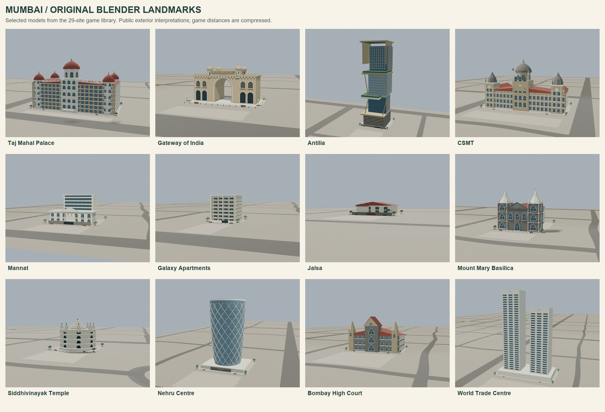
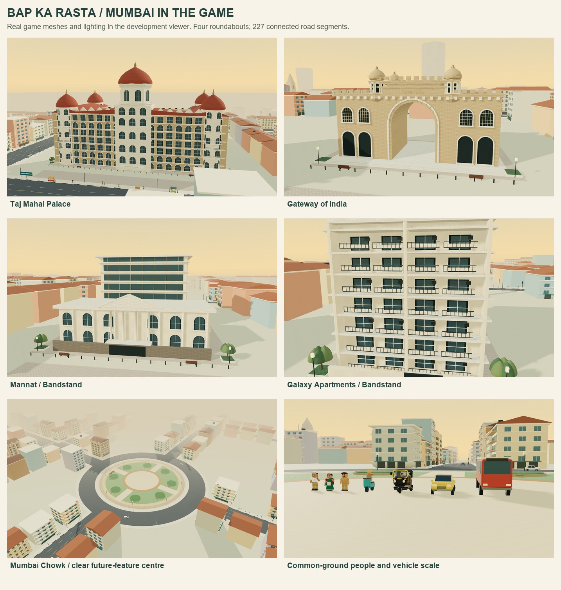
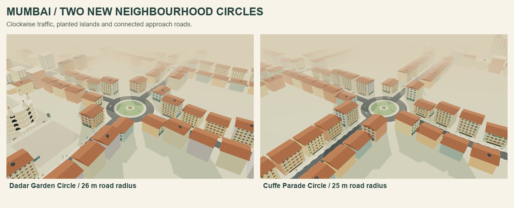

# Mumbai landmark and scale review

The game contains 29 original Blender sites: 22 landmarks/residences and seven shops. These previews show the authored assets and the real game world in its development viewer. The city is a compressed Mumbai-inspired layout; the exterior models are architectural interpretations rather than surveyed replicas.

[Numbered city map](../maps/mumbai-game-map.png) · [Every site, height and photo source](../Mumbai-Landmarks.md) · [Editable Blender library and rebuild steps](../../assets/architecture/mumbai/README.md)

Mumbai Chowk is at the exact map centre, `(450, -40)`. Its level, unobstructed centre has a 20 m radius at Y = 0.32 m. Radial paths, eight garden beds, benches and lamps surround the reserved space. The full island is 100 m across. The centre's bronze inlay is an annulus, avoiding overlapping surfaces.

## Measured scale

The common-ground lineup uses the shipped character and vehicle models at their runtime scale. One world unit equals one metre. These measurements exclude any added pavement elevation; normal pavements rise 0.16 m above the street.

| Model | Measured height |
| --- | --- |
| Constable Patil | 1.80 m |
| Meera | 1.60 m |
| Sachin, standing | 1.73 m |
| Scooter with rider | 1.95 m |
| Auto canopy | 2.074 m |
| Car | 1.55 m |
| BEST midi bus | 3.10 m |

Standing profiles across the full cast range from 1.56–1.81 m before small background-character variation. A normal passenger car roof can be lower than an adult's head. Both character detail levels receive the same stature correction, including animation pivots. Vehicle bodies use length-aware collision and following clearances.

## Verification and reproduction

The production build, viewer TypeScript checks and all 89 unit tests pass. Layout checks cover every landmark envelope and approach, road connectivity, four circles, distributed traffic, real GLB heights, distant silhouettes, fingerprints, cancellation and clean scene retries. Chrome checks exercise driving, mobile controls, asset loading and graphics-context recovery; the recovery test passes its existing 20-second retry expectation. See the [playable guide](../Mumbai-Playable.md#validation) for browser and device limitations.

The local Chrome fixed-view fixture on 1 November 2026 measured 3.47 ms per scene update and 12.63 ms per render at 844 × 390, with 406 draw calls and 958,142 submitted triangles. This fixture uses a hemisphere light without the game's sun/shadow pass and does not measure full driving FPS or phone performance. Run `node scripts/measure-rendering.mjs` with the development server on port 4176 to repeat it.

Open `/tools/landmark-preview/` on the development server to inspect all sites, street/overview perspectives, both graphics settings and the scale lineup. Blender review renders go to `output/playwright/landmark-renders/`; game captures use the `final-SITE.png` names in that directory. Run `python scripts/landmarks/build_previews.py` after rendering/capturing to regenerate this gallery. All images here show original project meshes; reference photographs are not redistributed.
