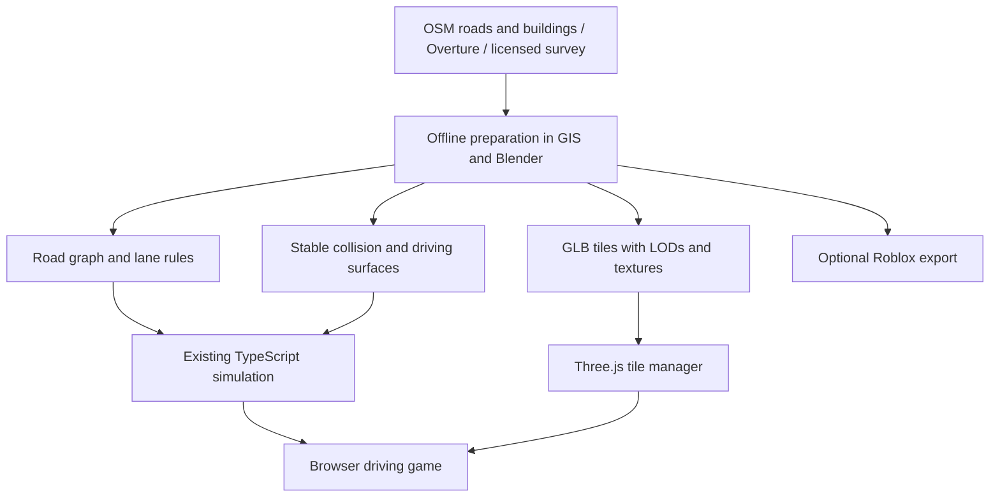

# Efficient real-city loading in the browser

Prepared on **27 October 2026** for Bap ka Rasta's existing React/TypeScript/Three.js architecture. This is the production integration plan; its budgets are starting targets. A separate free data/Blender/tile-streaming preview is now verified; see [its measured results and commands](free-process.md).

[Research and source comparison](README.md) · [Verification index](sources.json)

**The user's updated direction is a curated/compressed Mumbai.** Follow [the curated building/road plan](curated-mumbai.md) for the intended game environment. The geographically contiguous district plan below is retained as a technical reference; use its loader, asset/lifecycle budgets and collision principles without requiring the whole real road network to replace the current authored map.

## The target

Recreate a contiguous part of **real Mumbai** with geographically aligned roads and buildings. Detailed street-facing buildings should match their actual reference. Estimated building heights and generic filler details should be identified in the source manifest. Start with one district, measure the browser cost, and expand without downloading the whole city at startup.

Recommended first area: **Churchgate and the adjacent Marine Drive frontage**, approximately 0.8 km². Suggested bounding box:

```text
West 72.819, South 18.930, East 72.829, North 18.937
Reference origin: longitude 72.824, latitude 18.9335
```

This is a proposed crop, not a surveyed boundary. Check the final route and crop in OSM/QGIS before committing assets. Gateway of India and much of Colaba lie outside this small district; add them in later geographic extensions rather than moving them into the initial neighbourhood.

Use **WGS84 coordinates** in source files, project Mumbai into **UTM zone 43N / EPSG:32643**, and subtract a local origin. Runtime coordinates stay in metres, with east as `+X`, up as `+Y` and north as `-Z`, matching the current game's north convention. Record both the original geographic origin and projected origin. Do not pass longitude and latitude directly to Three.js positions.

## One source, three independent runtime layers



The road graph controls navigation and traffic. Collision data controls where driving is possible. Visual meshes provide appearance. Their coordinate origin, feature IDs and road geometry must agree, but their detail levels and loading lifetimes differ.

A city GLB alone will not supply traffic routes, one-way rules, lights, safe resets, pedestrian crossings or the game's road containment. Those systems must be built from road data and validated against the visual scene.

## Data acquisition and preparation

### 1. Fetch a bounded, reproducible geographic snapshot

Use a district OSM extract, not the full India dataset in the browser. [Geofabrik](https://download.geofabrik.de/asia/india.html) provides an India PBF, but it is a large preparation input; crop it with GIS/Osmium tooling. Alternatively, export a small extent from OSM/Overpass or use [CADmapper's Mumbai DXF](https://cityfiles.cadmapper.com/cityfiles/mumbai.zip) for layout reference.

A reproducible pilot Overpass query is:

```overpass
[out:json][timeout:20];
(
  way["highway"](18.930,72.819,18.937,72.829);
  way["building"](18.930,72.819,18.937,72.829);
  relation["building"](18.930,72.819,18.937,72.829);
);
out body;
>;
out skel qt;
```

This query retrieves selected roads/buildings and member geometry; it is not an all-feature district export. Fetch coastline, land use, water and other needed layers separately. This query was attempted during research but did not return a usable dataset, so it is an unvalidated recipe, not a completed download.

If OSM footprint coverage is sparse, compare with [Overture's building data](https://docs.overturemaps.org/guides/buildings/). Its [Python client](https://docs.overturemaps.org/getting-data/overturemaps-py/) supports bounded GeoJSON export. A proposed preparation command is:

```sh
overturemaps download --bbox=72.819,18.930,72.829,18.937 -f geojson --type=building -o churchgate-buildings.geojson
```

The same bbox has now been downloaded with `scripts/city/fetch_overture.py` in an isolated Python environment. Its requests-based STAC adapter worked around an HTTP 403 from the normal access path. The original CLI command above is a generic recipe; [the tested process](free-process.md) gives the command used here. Overture bbox order is **west,south,east,north**; Overpass order is **south,west,north,east**.

Save source URL, release/snapshot date, bounding box, hash, license and original feature IDs. Resolve overlapping OSM/Overture footprints before modelling; simply concatenating the datasets creates duplicate buildings.

### 2. Prepare and validate the roads

Retain full polylines and split them at actual connected junctions. Do not turn each road into a straight endpoint-to-endpoint chord. Respect `oneway`, road class, available `lanes`/`width`, `bridge`, `tunnel`, `layer`, roundabout and access tags. Roads crossing in plan view at different levels are not automatically connected.

Define explicit fallbacks for missing width/lanes/height, labelled as estimates. Footways, stairs, railway and private/service access must not silently become normal driving roads. Keep left-side traffic rules for Mumbai and correct direction on each one-way segment.

Preserve the true road alignment and distances; record any widened turns, adjusted kerbs or closed routes as gameplay changes. Generate asphalt, pavement edges, driving containment and traffic centreline samples from the same normalized road geometry.

Build stable collider boundaries and a safe spawn/reset route independently of detailed visual tiles. Roads and collision proxies should be available ahead of the car even if a high-detail façade is still loading.

### 3. Prepare buildings at the right fidelity

Start with accurate footprints. Use measured height where available, explicit floor-based estimates where appropriate, and a documented fallback otherwise. Resolve building parts, roof structures and intersections with road corridors.

For the pilot, choose **10–20 route-facing actual buildings** for detailed reconstruction or appropriately licensed assets. These are a proposed modelling allocation, not a verified list of surveyed buildings. Match silhouette, setback, major window/balcony patterns, entrances and reference façade colours. Add accurate street furniture along the route.

Use reusable materials for asphalt/stone/concrete and texture atlases for recurring props. A generic atlas is efficient but should not erase characteristic details of the actual highlighted buildings. Distant geometry can use simpler roofs and façades at the correct location.

Use Blender as the editable source. Trial the free Blosm importer and OSM2World on the same crop, then choose by geometry correctness, material portability, preparation time and output cost. Upgrade to Blosm Pro only if its generic texturing saves useful work. Apply curves/modifiers and convert shader effects into ordinary textures/materials before export.

## Browser packaging and loading

### GLB tiles for the pilot

Divide scenery into spatial tiles of about **100–200 m**. Tile size is a tuning choice: avoid both thousands of tiny files and a giant mesh spanning the district. Preserve buildings as logical objects in the Blender source; merge compatible static geometry by material **within a tile** where it reduces draw calls. Repeated props should share geometry/materials or use instancing.

Create three visual tiers:

| Tier | Suggested use | Content |
| --- | --- | --- |
| Near | Player street and immediate junctions | Detailed façades, entrances, kerbs and street props |
| Mid | Adjacent blocks | Reduced building meshes and fewer props/materials |
| Far | Skyline/coast context | Very coarse blocks or spatial HLOD meshes |

Use overlapping transition distances/hysteresis so tiles do not constantly switch when a car sits near a boundary. Do not rebuild geometry every render frame.

Export glTF/GLB using ordinary PBR materials. [GLTFLoader](https://threejs.org/docs/pages/GLTFLoader.html) supports attaching Meshopt, Draco and KTX2 decoders. Prefer **Meshopt plus KTX2/Basis textures** as the first optimization candidate, benchmark against uncompressed output, and choose Draco only when its size/decoding tradeoff helps. Compression is not free: decoding and GPU upload also cost time.

[glTF Transform](https://gltf-transform.dev/) can help weld, simplify, deduplicate and compress prepared assets. Inspect output after simplification; indiscriminate decimation can destroy kerbs, signs and recognisable building silhouettes. Host browser decoder/transcoder resources with the app or a chosen CDN, and set CORS correctly for a separate asset host.

### Proposed asset structure

```text
assets/city-source/mumbai/churchgate/  # source metadata; owned/open assets only
public/cities/mumbai/churchgate/
  manifest.json                     # version, origin, tile bounds, URLs, LODs
  roads.json                        # normalized graph, lane rules, geometry
  collision.json                    # simplified stable collision representation
  tiles/                            # immutable/versioned browser GLBs
  credits.json                      # creators, data licenses and modifications
```

This is a proposed layout, not files already created. Do not put stock source files into a public repository or `public/` unless their license allows that exposure. The current project has no map keys/backend; the static district route can preserve that property with appropriately licensed assets.

### Tile-manager behaviour

1. Load a small manifest, the pilot road graph/colliders and a coarse visual tile first. Show real progress; make the spawn area usable without waiting for every district texture.
2. Select tiles using camera visibility, distance, car position and likely next roads. Prefetch around junction choices, including areas a driver can reach outside the camera view.
3. Bound concurrent fetching/decoding; start with **2–4 simultaneous tile requests** and profile it. Use a priority queue and ignore/cancel obsolete requests.
4. Keep the game loop running while loading. Use worker-based texture/mesh decoding where supported, and keep other heavy preparation out of the browser. Some glTF parsing, scene creation and GPU upload still occur on the main/render thread; schedule them in controlled batches.
5. Keep a memory-bounded LRU cache. Unload far tiles, while protecting the active driving area. Reference-count shared materials/textures before disposal.
6. Abort owned fetches when exiting a drive. Guard late loader callbacks so they do not insert meshes into a disposed scene. Dispose geometry, materials, textures, decoder workers and tile-manager listeners at teardown.
7. If an asset fails, retain a coarse visual fallback and stable road collision; offer a retry. Do not freeze controls while distant scenery downloads.

At approximately **65 km/h**, the car travels **18.1 m/s**. A 150 m look-ahead represents about **8.3 seconds** of travel. Size the collider/visual prefetch buffer from measured network + decoding delay, speed and likely turns; use larger or coarser coverage when the connection cannot keep up. Infinite prefetching defeats memory and bandwidth limits.

### Proposed performance targets

These are **initial total-scene targets**, including the game's traffic/crowd cost where applicable. They must be revised after profiling representative phones and a hardware-accelerated desktop.

| Measure | Initial target |
| --- | --- |
| Time until the spawn area can be driven | About 5 seconds on a warm 20 Mbps connection, then measure cold cache and slower networks |
| Initial city download | At most roughly 8 MB compressed; do not download the whole district before starting |
| Graphics responsiveness | 30 FPS or better on the chosen reference phone; 60 FPS desktop target |
| Visible triangles | Begin around 150k–300k on mobile, 500k–1M desktop, then profile the actual mix |
| Draw calls | Begin below roughly 150 mobile / 300 desktop; use instancing, atlases and spatial batching |
| Resident texture allocation | Begin around 64–96 MB mobile / 192–256 MB desktop; estimate decoded GPU cost, not PNG/GLB download size |
| Texture resolutions | Mostly 512/1024; reserve 2K/4K for a small number of close landmark assets |
| Loading concurrency | Start with 2–4 requests and a bounded decode/upload queue |

Measure renderer draw calls/triangles, frame-time spikes, network transfer, cache misses and estimated decoded texture/geometry memory. The current large traffic/crowd population means new scenery is not the entire GPU/CPU budget. Repeated Standard/Low switching and five-minute driving tests matter more than a single static screenshot.

Prefer one/few sun lights, bounded nearby shadows, shared materials and reduced shadow distance on phones. Keep cheap far-city geometry resident if it prevents an empty skyline. Avoid one material, shadow-casting light or full-resolution texture for every building.

## When to use 3D Tiles instead

Choose 3D Tiles when licensed survey geometry or district expansion becomes too large for manually managed GLB chunks. The [NASA-AMMOS renderer](https://github.com/NASA-AMMOS/3DTilesRendererJS) has a Three.js integration, hierarchical LOD, provider plugins and memory-limited caching. Its code license does not license the city dataset.

Keep it in the existing renderer/canvas as a scenery subsystem. Prefer this integration before replacing the game with a Cesium globe. [CesiumJS](https://github.com/CesiumGS/cesium) is well suited to geospatial viewers and large globe-based scenes; adopting a second full renderer would add camera, compositing and resource-lifecycle work to this local driving game.

For licensed third-party streamed tiles, respect the provider's allowed caching and hosting. For your own/open prepared tiles, use immutable URLs and CDN/browser caching. A monolithic 50 km model does not become efficient merely because its download is asynchronous: it needs spatial subdivision, LOD and bounded resident memory.

Even with reality mesh, keep authored/normalized collision and navigation data. A photogrammetry mesh can contain holes, cars baked into the road, fused trees, uncertain ground levels or incomplete façades. Changing visual LOD must not alter where the car can drive.

## Changes required in this repository

| Current module | Planned adaptation |
| --- | --- |
| `src/game/network.ts` | Add a normalized real-road-data adapter while preserving the public graph/query APIs. `streetPath()` currently generates special fictional curves/roundabout geometry; replace that behaviour for real polylines, including one-way roads. Recompute bounds, spawn, connectivity and district labels. |
| `src/game/simulation.ts` | Preserve the fixed-step loop and driving behaviour. Validate lane selection, curved turns, one-way restrictions, signals, traffic spawn/reset and containment on the new graph. |
| `src/game/world.ts` | Separate imported city scenery from gameplay objects. Avoid rendering duplicate procedural buildings/asphalt under the new tiles. Retain instanced reusable props where compatible. |
| `src/game/boundaries.ts` / `pavements.ts` | Generate matching map-edge/building/pavement boundaries from normalized geography. Existing authored boundary rows cannot be assumed to match real footprints. |
| `src/game/engine.ts` | Add manifest/loader/tile-manager lifetime, progress/error handling and cancellation. Preserve pause/resume, camera, HUD throttling and teardown. |
| `src/game/atmosphere.ts` | Validate imported material colour space, exposure, reflections and shadow budgets in both quality modes. |
| `src/game/Game.tsx` | Expose useful loading/retry feedback without blocking the existing interface. |
| `docs/maps` generation | Generate the displayed playable map from the same normalized graph and boundaries used by the game. |

Road IDs and junction references need stable mapping. Real curves affect more than visual asphalt: nearest-road lookup, containment, lane offsets, traffic following and turn geometry must use the same sampled paths. A visual swap that keeps the fictional simulation network would leave traffic and collisions misaligned.

## Staged implementation and acceptance

| Stage | Deliverable | Evidence needed before expansion |
| --- | --- | --- |
| 1. Source pilot | Bounded road/building snapshot, provenance and quality inventory | Visually inspect missing footprints/heights, actual road connections and intended route |
| 2. Accurate driving base | Real graph, simple buildings, road surfaces and collisions | Multi-route drive; correct scale/one-ways; no false bridge connections, holes or building intersections |
| 3. Detailed street sample | One route with 10–20 actual route-facing buildings and reference-matched props | Street-level before/reference comparisons and validated material exports |
| 4. Browser loading | GLB LOD tiles, priority loading, cache and teardown | Cold/warm load, throttled network, rapid turns, cache eviction, repeated exits, frame-time and memory measurements |
| 5. District release | Coherent geographic pilot with Standard/Low modes and credits | Representative device runs and regression checks for driving, cameras, touch, orientation, pause and context loss |
| 6. Expansion | Adjacent Fort/Colaba/Marine Drive segments or licensed reality tiles | Maintain the same origin/IDs; prove bounded startup, memory and navigation across district edges |

Use the existing simulation/build/browser checks where relevant during production integration. Add meaningful assertions for new road topology, coordinate conversion, collider alignment and loading lifecycle. The isolated preview has focused selection, loading, cancellation and route checks, a geometry audit and Chrome validation. Production gameplay has not been changed by this preview.

**Recommended choice now:** a static, cropped OSM/Overture + Blender + GLB pilot, with actual detailed façades along the route. Seek a licensed reality-mesh sample only if higher fidelity across the entire district is worth the procurement/capture budget. Keep Roblox as a separate export target rather than a dependency.
