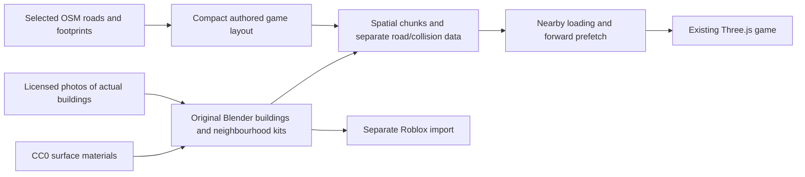

# Curated Mumbai: actual landmarks, neighbourhoods and selected roads

Updated **27 October 2026** to reflect the requested direction: a compact, playable Mumbai assembled from recognizable real places, famous buildings, chawls and selected roads. Preserve the current game's connected layout and driving feel, and replace its generic/loosely inspired structures with reference-based building assets.

[Verified free preparation and streaming process](free-process.md) · [Source catalog](curated-assets.json) · [Broader source research](README.md)

## Recommended approach

Use **OSM/Overture selectively for road curves, footprint dimensions and neighbourhood layout references**. Use **free exterior photographs + original Blender modelling** for the buildings' recognizable appearance. Arrange the selected places into a compressed game map, keeping the identities of Colaba, Fort, Marine Drive, Girgaum, Malabar Hill and Bandra readable.

The already exported Churchgate crop is a technical test of geographic conversion and partial loading. Its untextured footprint extrusions are not the intended finished art. A successful loader does not make those cubes acceptable substitutes for the actual Taj, Antilia, Mannat or a chawl.

The free process is:



No paid city model, paid Blender add-on, Google map key or city-wide survey is required. The substantial cost is modelling and validating the actual architecture. Free photos provide references; they are not finished 3D assets or a reliable one-photo-to-building reconstruction.

## First building and neighbourhood selection

The catalog records the source photo, author, license and a modelling brief for each item. The links below were verified through Commons' image metadata; Antilia and Mannat were also opened and read in Chrome.

| Actual place | What the Blender model should preserve | Free reference and verified license |
| --- | --- | --- |
| **Gateway of India** | Central arch opening, side pavilions, turrets, stone detail and recognizable proportions; a real opening with depth | [Exterior](https://commons.wikimedia.org/wiki/File:Gateway_Of_India,Mumbai.JPG), CC BY-SA 3.0 |
| **Taj Mahal Palace** | Main red dome, cream/red façade rhythm, corner towers, arcades, roofline and the visible waterfront elevation | [Hotel exterior](https://commons.wikimedia.org/wiki/File:Taj_Mahal_Palace_Hotel.jpg), CC BY-SA 3.0; [panorama](https://commons.wikimedia.org/wiki/File:Panoramic_view_of_Taj_Palace_Hotel_and_Taj_Tower_with_the_iconic_Gateway_of_India_in_the_background.jpg), CC BY-SA 4.0 |
| **CST / CSMT** | Main dome, Gothic stone façade, pointed arches, turrets and the street-facing station frontage | [Exterior](https://commons.wikimedia.org/wiki/File:Chhatrapati_Shivaji_Terminus_(Victoria_Terminus).jpg), CC BY-SA 3.0 |
| **Soona Mahal, Marine Drive** | Its particular Art Deco corner, curved balconies, horizontal bands and actual façade colours | [Close-up](https://commons.wikimedia.org/wiki/File:Closeup_of_Soona_Mahal,_Marine_Drive,_Mumbai.jpg), CC BY 4.0 |
| **Savitribai Phule Girls Hostel, Marine Drive** | The identified building's façade and coastal street frontage; validate all sides used in play | [Exterior](https://commons.wikimedia.org/wiki/File:Savitribai_Phule_Girls_Hostel,_Marine_Drive,_Mumbai.jpg), CC BY 3.0 |
| **Antilia** | The actual offset stacked volumes, terrace gaps, exposed structure, gardens and glass/metal façade pattern | [DesiBoy101 exterior](https://commons.wikimedia.org/wiki/File:Antilia,_Mumbai.jpg), CC BY 4.0 |
| **Mannat** | Publicly visible bungalow frontage, entrance/gate and characteristic exterior details shown by the reference | [Kushared exterior](https://commons.wikimedia.org/wiki/File:Mannat_SRK_House.jpg), CC BY-SA 4.0 |
| **Keshavji Naik Chawl, Girgaum** | The particular courtyard/verandah arrangement, balcony rails, doors, stairs and façade treatment in the photographs | [Reference 1](https://commons.wikimedia.org/wiki/File:Keshav_ji_naik_chawl-Mumbai,Maharashtra_(2).jpg) and [reference 2](https://commons.wikimedia.org/wiki/File:Keshava_ji_naik_chawl-Mumbai,Maharashtra_(3).jpg), CC BY-SA 4.0 |
| **Bhendi Bazaar street frontage** | Mixed-use buildings, shop shutters, awnings, balconies, street density and the chosen reference period | [Old Bhendi Bazaar](https://commons.wikimedia.org/wiki/File:Old_bhendi_Bazaar.jpg), CC BY-SA 4.0 |
| **Colaba Causeway shops** | Identified shopfront rhythms, pedestrian edges, signs, street stalls and continuous frontage | [Street reference](https://commons.wikimedia.org/wiki/File:Colaba_Causeway,Mumbai_-_panoramio.jpg), CC BY 3.0 |
| **Carter Road / Bandra coast** | Promenade, coastal road character and adjoining built frontage; useful context for the Bandra zone | [Street](https://commons.wikimedia.org/wiki/File:Carter_Road,_Bandra,_Mumbai.tif), CC BY-SA 4.0; [panorama](https://commons.wikimedia.org/wiki/File:Panoramic_View_of_Carter_road_(36012699812).jpg), CC BY 2.0 |

These are reference sources for modelling. **No downloadable, commercial-ready 3D version is being claimed for these photos.** The catalog marks all proposed finished models as unbuilt. Source dates matter: Mannat's verified photo is from 2019; Antilia's selected photo is from 2026. Match the chosen period consistently, and obtain additional viewpoints before claiming complete current accuracy.

Jalsa and Ranwar/Bandra village houses can be later additions. The targeted Commons searches did not establish suitable building-reference results for them, so they are not included in the verified first catalog.

The previously found downloadable Gateway model is **CC BY-NC**, and the detailed Taj viewer does not establish a free downloadable license. They are unsuitable as the default assets for a potentially monetized game. Original models based on licensed references provide a workable free route.

## Arrange it like a coherent small game city

| Game area | Proposed contents | Relationship to the current map |
| --- | --- | --- |
| Western coastal drive | Marine Drive curve, actual Art Deco façades, promenade and Chowpatty context | Replace the west-side procedural waterfront frontage |
| Southern waterfront | Gateway, Taj and Colaba Causeway frontage | Replace the existing Gateway-inspired arch and southern generic blocks |
| Heritage/station quarter | CST frontage, Fort arcades and selected heritage buildings | Replace the station silhouette and nearby generic frontage |
| Chawl and market quarter | Girgaum chawl courtyard, Bhendi Bazaar shop streets, distinct ordinary façades | Use existing Chawl Lane/Bazaar Galli connectivity, with distinct labels for Girgaum and Bhendi Bazaar |
| Northern landmark approach | Antilia exterior in a Malabar Hill/Pedder Road-themed block | Use or adapt the northern approach while keeping road containment aligned |
| Bandra pocket | Mannat frontage and Carter Road coastal context | Add a compact connected Bandra zone or a later separate streamed district |

The relative city distances and connecting streets are intentionally edited for gameplay. Record this in the map description as a **curated/compressed Mumbai**. Keep a building's identifying architecture intact when moving it into the game layout; do not stretch a recognizable landmark to fit an arbitrary plot. Adapt the plot or use a recorded uniform scale.

Separate skyline/context buildings from places the auto approaches. Players should encounter actual detailed façades along every playable street, including ordinary chawls and shops. A few landmarks surrounded by hundreds of blank blocks would not fulfil the intended environment.

## Famous roads with four-lane and two-lane gameplay

Here, **four lanes means two in each direction**, and **two lanes means one in each direction**. These are game design choices; a real named road can have different counts or restrictions along different segments.

| Road or street reference | Proposed game treatment | Keep recognizable |
| --- | --- | --- |
| Marine Drive | Four-lane main coastal route | Coastal curve, median, promenade and Art Deco frontage |
| Pedder Road / Malabar Hill approach | Four-lane landmark connector | Urban frontage and the chosen approach to Antilia; fetch/validate the selected OSM segment |
| Colaba Causeway | Two-lane market road | Shopfronts, pedestrian activity, stalls and road-edge character |
| Carter Road | Two-lane Bandra coastal loop | Waterfront promenade, trees and frontage |
| Girgaum/chawl streets | Two-lane local streets with narrower side alleys | Building proximity, verandahs, courtyard entrances and small shops |
| Bhendi Bazaar streets | Two-lane local market routes | Dense mixed-use frontage, tight turns and stalls outside the driving surface |

Preserve the current wide/narrow road system initially. Widths are currently 24 m for main avenues and about 10 m for many two-way local roads. Any later change to width/lane marking must update the visual roads, traffic paths, pavements and containment together. Imported real polylines need a compatible path adapter; current `streetPath()` contains authored curves and roundabout behaviour.

Use OSM/Overture as preparation inputs, not as a compulsory full city database at runtime. Retain real source road IDs and reference geometry in the catalog while allowing explicitly recorded gameplay edits to width, length and connections.

## Free Blender workflow that we can work on

1. **Build one real street sample first:** Soona Mahal/Marine Drive plus one chawl courtyard and shop frontage. Finish their appearance before multiplying the city.
2. Save each real building as a separate named source collection, with metres, a ground-level pivot, reference links and explicitly estimated dimensions. Use independent source scenes for major landmarks where useful.
3. Model the silhouette and depth first, then actual balconies, windows, entrances, stairs and roof details. Shared window/railing/AC/piping components are appropriate; the resulting façade layout should follow that building's references.
4. Use CC0 stone/asphalt/concrete surfaces from [Poly Haven](https://polyhaven.com/license). Correct the actual building's colour and façade pattern from licensed photos; do not stretch a whole street photograph onto a cube. Additional real viewpoints are needed for hidden sides.
5. Create near, mid and far versions. Bake fine stone/window/rail details into normal/colour textures for the reduced versions. Use shared texture atlases and transparent/detail materials sparingly.
6. Export each finished building as a normal PBR GLB. Place instances into the authored city, then batch static compatible geometry within approximately 125 m spatial chunks. Keep simplified colliders and road rules separate.
7. Reuse the verified nearby/forward loader, with a memory budget suited to the new textured assets. It already protects nearby tiles, fetches ahead, bounds concurrent loads and disposes old scenery.
8. Validate the actual close-up appearance against the reference and drive the affected routes. Only then expand to the Taj/Gateway, CST, Antilia and Mannat collections.

The local Blender command interface already works. We can generate base geometry, build reusable façade components, assemble scenes and export tiles through scripts. An interactive Blender connection will help select/edit parts and inspect detailed architecture. Detailed reference matching still requires an iterative art pass; a simple scripted extrusion is not the finished building.

### Export hand-edited buildings

Use `scripts/city/export_authored.py` for finished/manual Blender work. This opens the saved `.blend` in a fresh background process and exports existing geometry; it does not rebuild the footprint scene or save over the source.

In a metre-based source scene, parent each building's meshes to a top-level Empty with a **`city_asset` string property**, such as `soona-mahal`. Keep that building's parts under the same root. The exporter keeps the building together, assigns it to a spatial tile and records its full bounds. Split long roads and ground into local pieces first.

```powershell
& 'D:/Blender/blender.exe' --background --factory-startup --python-exit-code 1 --python scripts/city/export_authored.py -- --source 'assets/city-source/curated-mumbai/curated-city.blend' --output 'output/playwright/curated-mumbai/export' --tile-size 125
```

The source path above is the proposed authored scene, not an existing completed city. `--all-meshes` can export an untagged scenery-only source; tagged roots are preferred for keeping landmark components together. Bake unsupported procedural shaders into ordinary PBR textures before export. The output manifest/GLBs fit the same tile-loader interface; road/collision data and credits must accompany them when integrated into the game.

The exporter was verified on the saved 80-tile sample and on a tagged building-root test with components crossing tile boundaries. The source files remained unchanged, the components stayed together, and Chrome confirmed the GLB's world positions, vertical scale and manifest bounds.

The game-specific changes should primarily live in `world.ts`/new scenery-loader modules and its lifecycle in `engine.ts`. Keep the authored road network initially; adapt `network.ts` only for the selected geometry changes. This is a smaller integration than replacing every road with the Churchgate extract. The existing Gateway/station placeholders and procedural frontage should be replaced where the new models are installed.

## Partial loading and Roblox

The same streaming principle applies to this curated city. Load a small nearby buffer plus blocks ahead; keep coarse skyline context and stable road/collision data available. Strictly front-only rendering would expose empty surroundings when steering or reversing.

The tested untextured sample loads 15/80 tiles initially, caps resident tiles at 22 and limits requests to 3. Those are evidence that the mechanism works, not performance guarantees for detailed façades. Add decoded texture/geometry memory limits and use LODs before public release.

For Roblox, export compatible uncompressed GLB/FBX from the same building sources, check metre-to-stud scaling, anchor static scenery and enable Workspace instance streaming. Keep models/chunks individually streamable and use simple colliders. See [the verified-process guide](free-process.md#use-the-same-source-in-roblox) for importer links and specifications. Studio integration remains untested.

## Rights and readiness

CC BY references require credit, a license link and modification notices. CC BY-SA references also require the appropriate share-alike treatment of derivative photographs/textures/assets. Keep those art assets and their notices separately identifiable; this does not automatically make unrelated game code CC BY-SA. Prefer original photographs or CC0 material where possible, and preserve per-file licenses rather than assuming all Commons files share one license.

The catalog currently contains **verified references and modelling briefs**. The data pipeline, Blender export and tile-loading mechanism work. The authored, recognizable finished building models have not yet been made or installed in production. Research did not find one free, verified asset pack supplying this whole selection at the requested fidelity.
