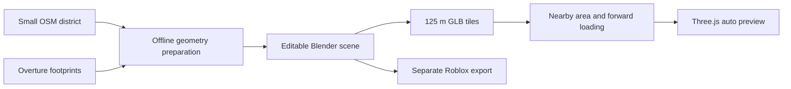

# Free real-Mumbai map process: tested with Blender and Chrome

Verified on **27 October 2026** in Bap ka Rasta. **OpenStreetMap + Overture + Python + Blender + Three.js works without a paid map service or plugin.** A Churchgate/Marine Drive sample has been downloaded, converted into editable Blender geometry, exported as small GLB tiles, and tested in visible Chrome.

[Source comparison](README.md) · [Production integration plan](browser-plan.md) · [Verification index](sources.json)

**Updated art direction:** use [the curated Mumbai plan](curated-mumbai.md) for actual landmarks, chawls, neighbourhood façades and selected roads arranged like the current game. The district extract described here verifies the free preparation/streaming mechanism; its footprint cubes are only technical test geometry.

## Open the working sample

With the project's development server running, open:

**http://127.0.0.1:5173/tools/city-preview/index.html**

Use **W/S** to move and **A/D** to steer, or select **Drive along Marine Drive**. **Map view** shows the loaded blocks from above. This sample uses the game's existing auto model and follows one continuous OSM carriageway for automatic driving.

The editable Blender scene is:

```text
D:\Personal Project\Game 1\output\playwright\free-city\export\churchgate-source.blend
```

Blender **3.5.1** was found at `D:\Blender\blender.exe` and successfully exported the scene in a fresh background process. A Blender connection is useful later for interactive detailing; preparation and export already work locally.

This is a working geographic geometry and streaming preview. Production traffic, collisions, road rules, detailed façades and mobile profiling remain integration work.

## What the free data actually supplied

The crop is west **72.819**, south **18.930**, east **72.829**, north **18.937**: approximately **1.06 × 0.79 km**, including part of Churchgate and Marine Drive. It is a district sample of Mumbai.

| Verified item | Result |
| --- | --- |
| OSM map API snapshot | HTTP 200; 1,270,431 bytes; 2,445 nodes and 455 ways |
| Raw OSM building ways | 139; relation geometry is processed separately |
| Exported road/path ways | 216, including footways; these are not all drivable streets |
| Overture buildings download | Release `2026-10-21.0`; 197 features; 129,968-byte GeoJSON |
| Overture contribution after overlap matching | 46 additional footprint pieces retained; 151 overlapping pieces excluded |
| Combined building geometry | 197 polygon pieces with 196 unique source IDs |
| Height information | 1 supplied height, 30 estimates from floor counts, 166 default estimates |
| Spatial export | 80 GLB tiles on a 125 m grid; 970,636 bytes total, about 0.97 MB |
| Geometry audit | All 749 generated mesh pieces have two incident faces per edge |

The Overture source records in this download identify 150 OSM features and 47 Google Open Buildings features. **Google Open Buildings is open geographic data used by Overture; it is separate from extracting Google Maps imagery or photorealistic tiles.** The retained Overture source records, dataset release, hashes, OSM IDs and original XML remain available in the prepared output.

The one supplied height is a source property, not an independently verified survey measurement. Floor estimates use **3.2 m per floor**; the fallback is **15 m**. Widths use available width/lane tags or documented class estimates. The output labels these assumptions.

Real footprints give the actual mapped positions and outlines. **They do not give the real windows, balconies, signs or photographed wall textures.** The sample uses generic solid materials and flat road surfaces. It does not reproduce bridge/tunnel elevations, individual roof structures or detailed pavements. The coastline follows OSM with an explicit Mumbai-specific assumption that the sea is west of the coast; this rule needs replacement for another coastline.

## How partial loading works



The browser fetches a small manifest and road polylines, then requests individual scenery tiles. It never needs the raw OSM XML or full Overture download at runtime.

The preview selects tiles within about **140 m** of the auto, plus a forward corridor reaching about **350 m**, allowing for tile bounds. Keeping a nearby area covers turns, reversing and the rear camera. A strictly front-only rule would leave visible holes when the auto turns or looks back.

| Runtime setting | Tested value |
| --- | --- |
| Desired tile limit | 18 |
| Resident cache limit | 22 |
| Concurrent loads | 3 |
| Selection refresh | About 150 ms |
| Initial load at the current route spawn | 15 of 80 tiles; 266,348 bytes of GLBs, about 260 KiB |

Movement tests requested additional tiles, changed the forward set on reversal, and evicted old scenery while keeping every currently desired tile. Across five test poses, the resident count stayed at **22 or fewer**; **46 tiles were evicted**. Stopping disposed the city meshes, leaving the auto's geometry.

A separate Chrome test deliberately held all three tile downloads. The render counter continued and **W** still moved the auto. Stopping aborted the requests; releasing them afterward did not resurrect scenery. Focused tests also cover the case where an already aborted mesh parse finishes after a rapid reversal.

The figures are local prototype measurements. GLB byte counts exclude metadata, JavaScript and the existing vehicle. Browser caching can serve repeat requests; the counter sums completed mesh loads and is not a wire-transfer meter. There are no façade textures or LOD levels yet. A tile-count cap alone is insufficient for a future textured city: add decoded-memory limits, LODs, compression and a stable coarse fallback, then profile representative phones.

## Reproduce it for free

Run these PowerShell commands from `D:\Personal Project\Game 1`. The Python environment is isolated from the game dependencies. Use a stable Python 3.11+ installation for the pinned preparation stack. This machine's existing Python 3.11 installation successfully ran it. The project recommends Node 22.18+ on the 22.x line, or Node 24.

```powershell
python -m venv output/playwright/free-city/.venv
& 'output/playwright/free-city/.venv/Scripts/python.exe' -m pip install -r scripts/city/requirements.txt

& 'output/playwright/free-city/.venv/Scripts/python.exe' scripts/city/fetch_overture.py --output output/playwright/free-city/overture-buildings.geojson

& 'output/playwright/free-city/.venv/Scripts/python.exe' scripts/city/prepare_city.py --overture output/playwright/free-city/overture-buildings.geojson

& 'D:/Blender/blender.exe' --background --factory-startup --python-exit-code 1 --python scripts/city/blender_export.py -- --prepared output/playwright/free-city/prepared --output output/playwright/free-city/export

npm run dev -- --host 127.0.0.1
```

The preparation command fetches the bounded [OSM map API](https://api.openstreetmap.org/api/0.6/map?bbox=72.819,18.930,72.829,18.937) when `--osm` is absent. For a repeat export from the saved snapshot, supply:

```powershell
& 'output/playwright/free-city/.venv/Scripts/python.exe' scripts/city/prepare_city.py --osm output/playwright/free-city/prepared/source.osm --overture output/playwright/free-city/overture-buildings.geojson
```

The Overture script uses its official Python reader with a public HTTP adapter for STAC access. The normal urllib access returned 403 here; the adapter worked. It refuses a full-dataset fallback when the spatial index is unavailable. The successful crop selected one Parquet partition and produced the bounded GeoJSON. Each fresh download selects the latest available release; retain the saved GeoJSON and sidecar to reproduce this particular snapshot.

For another small district, pass the same `--bbox=west,south,east,north` to **both** data commands. Both scripts reject large requests; the coastline and preview route are intentionally specific to this Mumbai sample. Prepare neighbouring districts offline rather than requesting a whole city from the public OSM map API or doing GIS conversion while someone drives.

## Files and responsibilities

| File | Purpose |
| --- | --- |
| `scripts/city/requirements.txt` | Pinned free Python preparation dependencies |
| `scripts/city/fetch_overture.py` | Bounded Overture download and release sidecar |
| `scripts/city/prepare_city.py` | OSM parsing, overlap filtering, projection, tagged estimates and triangulated input |
| `scripts/city/blender_export.py` | Background Blender scene generation and per-tile GLB export |
| `scripts/city/export_authored.py` | Export existing hand-edited Blender scenery into tiles while preserving the source |
| `tools/city-preview/streaming.ts` | Nearby/forward selection, bounded request/cache management and disposal |
| `tools/city-preview/route.ts` | Continuous one-way Marine Drive sample route joined by OSM node IDs |
| `tools/city-preview/preview.ts` | Isolated Three.js viewer and controls |
| `tools/city-preview/streaming.test.ts` | Loading limits, cancellation, disposal and route regression checks |

Output under `output/playwright/free-city/` is local and git-ignored. It includes the raw inputs, provenance, `prepared/`, and `export/manifest.json`, `roads.json`, `buildings.json`, `tiles/*.glb` and the `.blend` scene. These assets can be regenerated from the scripts; they are not included in the main game build.

The coordinate system projects WGS84 into **UTM 43N / EPSG:32643**, subtracts the crop centre, and uses **metres**, east `+X`, up `+Y`, north `-Z`. Blender uses its normal Z-up system; glTF export restores Y-up. Neighbouring crops need one shared origin or an explicit manifest transform to align them.

## Make it look closer to actual Mumbai without paid assets

Keep the free footprint base, then detail the buildings the player sees from the route. Start with roughly **10–20 street-facing buildings**, using their actual names, silhouettes, colours, balconies, windows and shopfronts. Hotel Marine Plaza and Soona Mahal are examples present in the OSM snapshot; reference their specific architecture rather than inventing generic replacements.

Use your own ground photographs or photographs with explicit reuse rights. [Wikimedia Commons](https://commons.wikimedia.org/) can provide building references; each file has its own license and attribution. The free Blender scene provides scale and placement, but its current objects are grouped by material within tiles. For individual façade work, use the preserved footprint IDs/data to create separate editable building objects, then bake and rebatch the finished export.

[Poly Haven](https://polyhaven.com/license) and [ambientCG](https://docs.ambientcg.com/license/) provide CC0 surface materials for asphalt, concrete and stone. These improve material appearance; actual façade identity still needs reference-based work. UV-map, bake ordinary PBR materials, atlas recurring details, and share textures. Add kerbs, road markings, promenade rails, trees and signs where they actually occur. Verify every estimated height you replace.

For a free GUI-led alternative, the [Blosm base importer](https://github.com/vvoovv/blosm) or [OSM2World](https://osm2world.org/) can create starting geometry. They were researched, but this verified sample uses the repository's scripts. Neither creates photographed façades for every building from OSM.

## Use the same environment in the current game

Reuse the tile selector/loader inside `engine.ts`, with lifecycle cleanup when a drive exits. Put deployable, versioned assets under a chosen `public/cities/...` directory and change the preview's asset base; the present preview depends on the development server serving local ignored output.

Adapt `network.ts` to use the actual polylines and connected junctions, preserving its APIs for simulation. Build road containment, simple building/kerb collisions and safe resets from the same geographic coordinates. Replace overlapping procedural scenery in `world.ts`. Validate Mumbai's left-side driving and tagged one-way roads before adding traffic.

Keep collision/road data ready beyond the visual loading radius. The auto must not fall through a road or collide with missing scenery when a façade file is delayed. Add retry/fallback UI, byte-based cache limits and controlled decode/upload work. See [the full browser plan](browser-plan.md) for the affected modules and staged acceptance criteria.

## Use the same source in Roblox

The researched route is **Blender → separate compatible GLB/FBX export → Roblox Studio → Workspace streaming**. The current uncompressed GLBs are reasonable import candidates; their actual Studio import has not been tested.

Use [File → Import](https://create.roblox.com/docs/studio/importer), inspect scale and hierarchy, anchor static MeshParts, and add simple collision proxies. Keep each mesh within Studio's [20,000-triangle specification](https://create.roblox.com/docs/art/modeling/specifications). Preserve blocks as separately streamable objects rather than making the whole city one persistent model. Use standard textures/[SurfaceAppearance](https://create.roblox.com/docs/art/modeling/surface-appearance); prepare a separate export if the browser later uses Meshopt/KTX2 extensions.

Set import units to metres and confirm a 10 m reference measures approximately **35.71 studs** under the [standard 0.28 m per stud convention](https://create.roblox.com/docs/physics/units). Avoid converting both the source and the importer.

Enable [Workspace.StreamingEnabled](https://create.roblox.com/docs/workspace/streaming). A possible test starting point is a **256-stud minimum** and **1,024-stud target** radius, approximately 72 m and 287 m; these are suggested values, not a tested configuration. Roblox streams around the character/replication focus and manages residency; it does not expose the browser preview's directional tile queue. Drive into newly streamed regions and verify collisions, vehicle physics and asset permissions before expanding.

WorldLoader remains a researched Studio-only alternative. It has not been installed or verified here, and its OSM-derived output still needs appearance and gameplay work.

## Credits and verification

Display [© OpenStreetMap contributors / ODbL](https://www.openstreetmap.org/copyright), [Overture attribution](https://docs.overturemaps.org/attribution/) and any material/photo credits. Keep the modified geographic database and provenance available as required by ODbL when distributing it. These data obligations do not automatically apply ODbL to unrelated game code.

Verified: public data retrieval, projection, overlap filtering, Blender export, closed-edge geometry, Chrome rendering, movement-driven requests, reversal selection, eviction, held-download responsiveness and late-load disposal. Focused TypeScript and lifecycle checks pass. Detailed façade accuracy, production driving integration, Roblox import and mobile frame-rate targets remain unverified.
