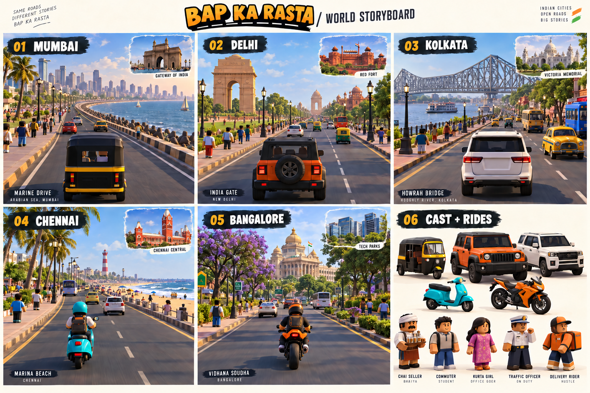
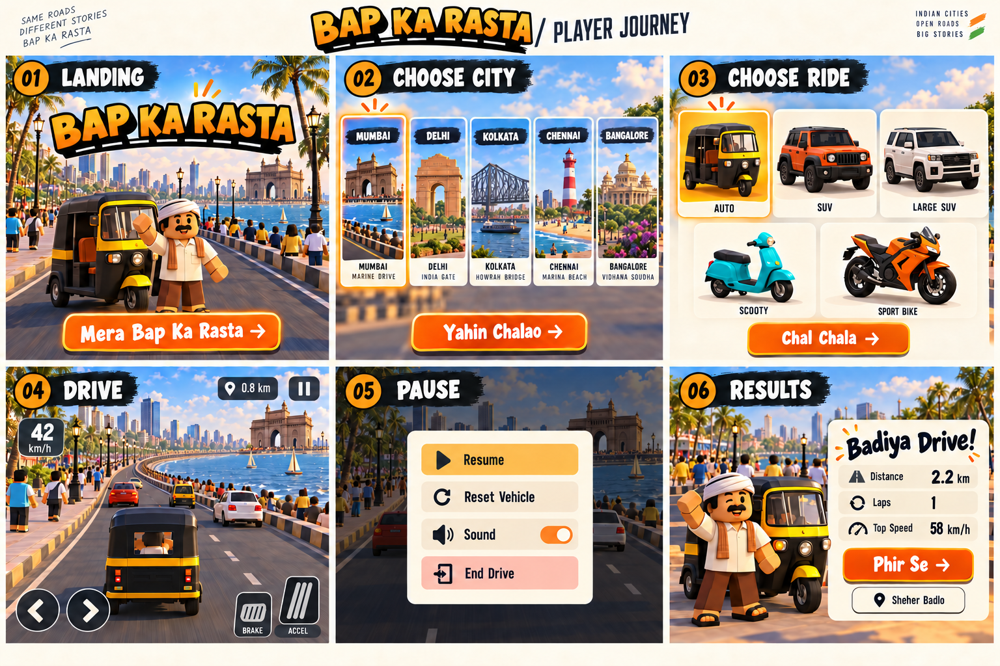

# Bap ka Rasta visual storyboard

These two generated concept boards are the primary visual reference for the first game implementation. Read them alongside the [game specification](../Bap-ka-Rasta-Game-Plan.md). They establish atmosphere, silhouettes, landmarks, and screen composition; they are not screenshots of an implemented game.

## 1. Cities, cast, and vehicles

Read left to right, top to bottom. Each city has a driving composition and secondary landmark reference. Landmark arrangements are fictional scenic compositions, not accurate street maps.

| City / route | Main location | Secondary reference | Player vehicle shown | Distinctive cues |
| --- | --- | --- | --- | --- |
| Mumbai / Samundar Loop | Marine Drive | Gateway of India | Auto rickshaw | Curved sea wall, dense skyline, black-and-yellow taxis |
| Delhi / Dilli Boulevard | India Gate avenue | Red Fort | Boxy off-road SUV (Thar role) | Broad roads, sandstone, lawns, landscaped islands |
| Kolkata / Hooghly Hop | Howrah Bridge and Hooghly riverside | Victoria Memorial | Large SUV (Fortuner role) | Steel trusses, yellow taxis, older street facades |
| Chennai / Marina Cruise | Marina Beach and lighthouse | Chennai Central | Scooty | Wide sandy shore, palms, red station architecture |
| Bangalore / Garden City Run | Cubbon Park-inspired avenue and Vidhana Soudha | Modern tech district | Sport motorcycle (KTM role) | Green canopy, flowering trees, cream civic architecture |

The vehicle-to-city pairings are illustrative. All five vehicles remain selectable in every city. Secondary monuments are additional visual references; introduce them as distant silhouettes or optional scenic landmarks after the core circuits work.

### Shared art direction

- Original blocky characters: square heads, simple friendly faces, chunky limbs, readable clothes, and a consistent human scale. Use the Roblox-like proportions as a stylistic reference while building original meshes and textures.
- NPC roles: chai seller, commuter, kurta-wearing pedestrian, traffic officer, and delivery rider. Vary clothing, skin tone, hair, and accessories. Keep pedestrians on pavements in the first version.
- Vehicles: compact three-wheeled auto, upright off-road SUV, longer large SUV, turquoise scooter, and orange sport motorcycle. Use original silhouettes and omit manufacturer badges. Riders wear helmets.
- Warm daylight, flat material colours, cream/orange/teal UI, readable road silhouettes, and modest shadows. Simplify the concept images' dense crowds, foliage, reflections, and architectural detail to fit the specification's mobile rendering budgets.
- Implement left-hand traffic and consistent lane directions explicitly; generated traffic arrangements are not a lane-layout specification.

## 2. Player journey

1. **Landing:** city illustration, original driver character, and **Mera Bap Ka Rasta** action.
2. **Choose city:** five equally available city cards; Mumbai initially selected. Use **Yahin Chalao** as the implementation label (the generated image varies this wording).
3. **Choose ride:** five vehicle cards, auto initially selected, **Chal Chala** to load the selected combination.
4. **Drive:** rear chase camera, speed, distance, pause, and large touch steering/brake/accelerator controls. Add horn and reset controls from the specification; retain a clear view of the road. The loading state occurs before this frame and is specified in the game plan.
5. **Pause:** dim the scene, stop simulation, and offer Resume, Reset Vehicle, Sound, and End Drive. Include the specification's remaining graphics and selection actions in the final responsive layout.
6. **Results:** distance, laps, top speed, **Phir Se**, and **Sheher Badlo**. Also provide the specified vehicle-change action and local best distance.

Treat drawn text, button contrast, and sample statistics as concept art. Implement actual accessible HTML controls and measured gameplay values. Use the specification for exact behavior where the illustration omits a control or state.

## Production order

Build the Mumbai/auto greybox first, then match the board's chase camera and broad colour blocks. Establish one reusable character rig and a small road/prop kit. Add the other four city silhouettes and five vehicle bodies using the same scale and materials. Verify mobile performance before increasing scenery density.

## Image provenance

Generated on 24 October 2026 with OpenAI image generation for this repository. The world board was generated from the game specification and the user's request for blocky characters, vehicles, and famous locations. The player-journey board used the world board as its visual reference. The PNGs are concept references, not ready-to-use 3D assets or measured render targets.
